# National Status and Passport with Daniel Mentz

| | |
|---|---|
| **Queue title** | Commoner | National Status and Passport with Daniel Mentz |
| **Video** | [YouTube: v2N5ESMKI4g](https://www.youtube.com/watch?v=v2N5ESMKI4g) · 1 h 35 m 43 s · published 2026-01-21 by Commoner Law Group |
| **Presenter** | Daniel Mentz, Sacred Honor Educational Fellowship (National Status & Passport Pathway) |
| **Host** | Clint Griess, Commoner Law Group |
| **Format** | About 49 min of slides ([04:42 to 53:45](https://www.youtube.com/watch?v=v2N5ESMKI4g&t=274s)), then about 41 min of audience Q&A ([54:21 to 1:35:43](https://www.youtube.com/watch?v=v2N5ESMKI4g&t=3253s)) |
| **Queue row ID** | `07213875-e6d8-4d00-b4ad-6c685bd2f24c` |
| **Collateral** | [Full transcript](collateral/transcript.md) · [video metadata](collateral/video-metadata.json) · [slide index](slides/) |

> **Reader's note.** This is a summary of what Mentz *says and shows*. His legal claims are reported as his claims, not verified here. The closing "Claims worth checking" section lists points a reader would want to check against primary sources before relying on them. Neither the presenter nor the host is giving legal advice, and the deck's own disclaimer says so (slide 2).

Each slide image is captioned with the time it first appears in the video. Every timestamp is a link that opens the video about 8 seconds before the stated time, so you have a moment to get ready.

---

## 1. Thesis in brief

Mentz argues that "citizen of the United States" is a 14th-Amendment, federal-corporate status and that a different, older status exists beside it: the pre-Civil War **state citizen**, which federal statute calls a **"national."** He says the statutes themselves let a person declare that status by sworn affidavit. The affidavit goes to the U.S. Secretary of State and is then followed by a passport application or renewal that attaches it. His claimed result is that a person leaves the federal-citizen jurisdiction, with practical consequences for income tax, traffic enforcement, jury duty and similar matters. The unifying idea is **dialectics**: the legal system uses double-meaning words ("United States," "State," "resident," "person") so that people consent to a status without knowing they are choosing.

---

## 2. Introduction and presenter background [\[00:00–04:42\]](https://www.youtube.com/watch?v=v2N5ESMKI4g&t=0s)

**Host intro ([00:00–02:25](https://www.youtube.com/watch?v=v2N5ESMKI4g&t=0s)).** Griess frames the evening as a custom presentation for an audience that already knows the topic area. It covers what changing status from "U.S. citizen" to "national" means, a compare-and-contrast with other processes, material benefits, "a spiritual benefit of just exiting the system," and Q&A.

**Mentz's story ([02:35–04:30](https://www.youtube.com/watch?v=v2N5ESMKI4g&t=147s)).**
- His "big awakening" came in 2020, when he asked how governments could trample a "very clear constitution and [bill of rights](https://www.archives.gov/founding-docs/bill-of-rights-transcript)" and face no repercussion for mask arrests and business shutdowns.
- He came across a Roger Sayles interview, which "gave me a huge chunk of the answer." That opened the "private remedy world" of equity, land patents and trusts.
- The man who introduced him to Sayles, John Cacero, is on the call and speaks at the end (section 8).

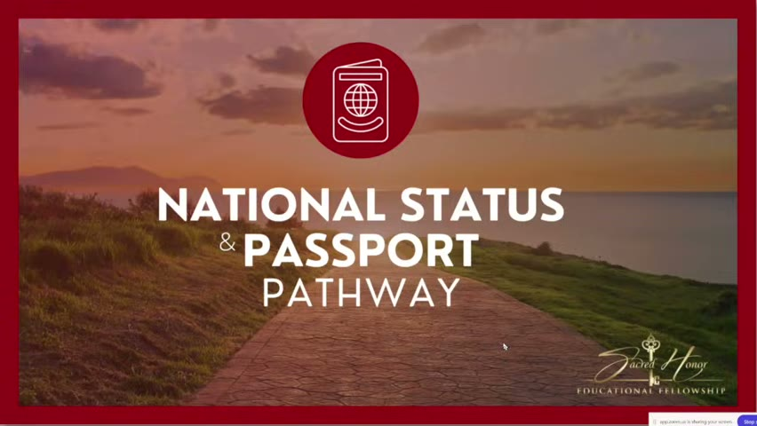
*Slide 1 [\[04:46\]](https://www.youtube.com/watch?v=v2N5ESMKI4g&t=278s): "National Status & Passport Pathway," Sacred Honor Educational Fellowship.*

---

## 3. Framing, credentials and ground rules [\[04:42–12:27\]](https://www.youtube.com/watch?v=v2N5ESMKI4g&t=274s)

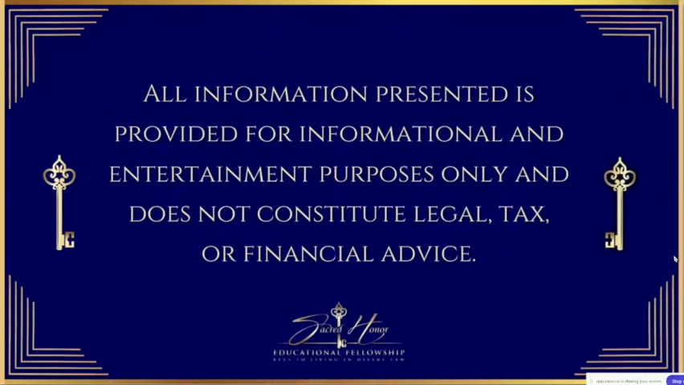
*Slide 2 [\[05:40\]](https://www.youtube.com/watch?v=v2N5ESMKI4g&t=332s): "All information presented is provided for informational and entertainment purposes only and does not constitute legal, tax, or financial advice."*

- Sacred Honor offers **four pathways**. National status is one, and the others are saved for the end (section 7).
- He calls this "the first and original" status-correction process, "perfected since 2007" with "a total combined 90+ years of research," attributed to the life's work of three men, with many people carrying it forward.
- He **dislikes the term "status correction"**: it implies something was incorrect, "when in fact it's flat out fraud and deception and mind control." What changes is the individual's *relationship* with the legal system.

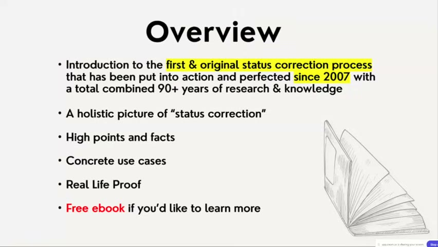
*Slide 3 [\[05:48\]](https://www.youtube.com/watch?v=v2N5ESMKI4g&t=340s): Overview: introduction to the "first & original" process, a holistic picture, high points and facts, concrete cases, real-life proof, free eBook.*

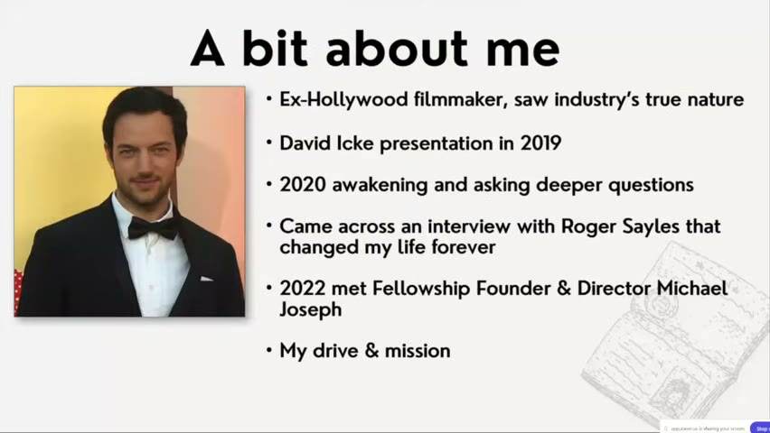
*Slide 4 [\[08:00\]](https://www.youtube.com/watch?v=v2N5ESMKI4g&t=472s): "A bit about me": ex-Hollywood filmmaker; David Icke presentation in 2019; 2020 awakening; the Roger Sayles interview; 2022 meeting Fellowship founder and director Michael Joseph; his drive and mission.*

- Background: he left film after seeing what the industry really wanted to produce. In 2019 he watched a David Icke presentation while researching a dystopian screenplay.
- In 2022 he met Fellowship founder Michael Joseph. Joseph had heard good things about the Sayles process but had never met anyone who had *practised* it and could teach it, so they partnered.
- His stated mission is to be "a signal in the noise," cohesive and clear about what status correction is and how it works.

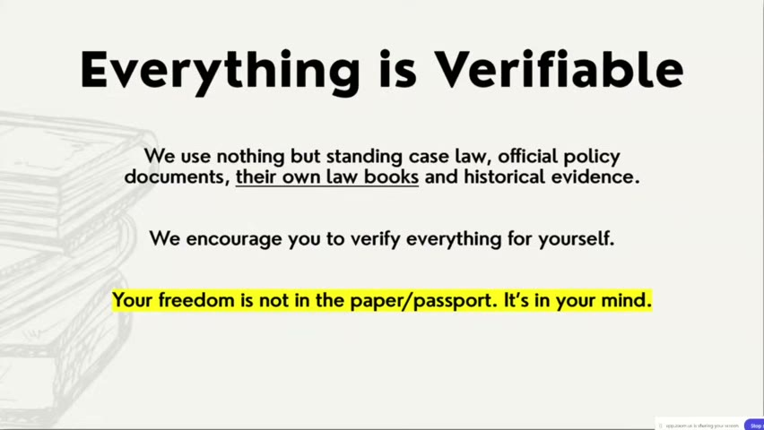
*Slide 5 [\[10:53\]](https://www.youtube.com/watch?v=v2N5ESMKI4g&t=645s): "Everything is Verifiable": "standing case law, official policy documents, their own law books and historical evidence." "Your freedom is not in the paper/passport. It's in your mind."*

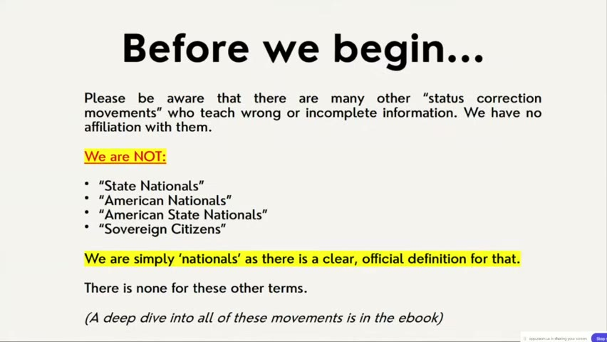
*Slide 6 [\[11:49\]](https://www.youtube.com/watch?v=v2N5ESMKI4g&t=701s): "We are NOT": "State Nationals," "American Nationals," "American State Nationals," "Sovereign Citizens." "We are simply 'nationals' as there is a clear, official definition for that."*

Mentz says he has **no affiliation** with other status-correction movements and covers them in the eBook. He also says "paper tigers," meaning the mail one receives, can be a *programmed fear*.

---

## 4. The case-law opening: "U.S. citizens are property; nationals/state citizens are not" [\[12:27–16:00\]](https://www.youtube.com/watch?v=v2N5ESMKI4g&t=739s)

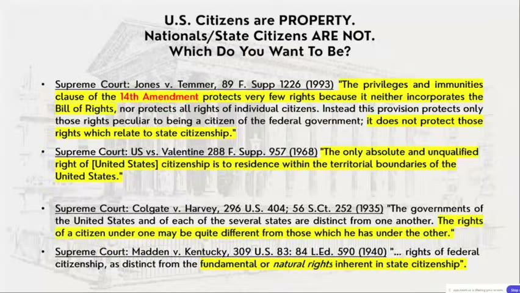
*Slide 7 [\[12:27\]](https://www.youtube.com/watch?v=v2N5ESMKI4g&t=739s): Four quotations the audience is invited to read along with.*

Mentz reads each quotation and draws a conclusion.

| Case (as shown on slide) | Quoted proposition | Mentz's takeaway |
|---|---|---|
| *[Jones v. Temmer](https://law.justia.com/cases/federal/district-courts/FSupp/829/1226/1876934/)*, 829 F. Supp. 1226 (D. Colo. 1993) (the slide prints "89 F. Supp 1226," apparently a typo) | The Privileges & Immunities Clause "protects only those rights peculiar to being a citizen of the federal government; it does not protect those rights which relate to state citizenship." | Federal citizenship protects very little. |
| *[U.S. v. Valentine](https://www.courtlistener.com/opinion/1641873/united-states-v-valentine/)*, 288 F. Supp. 957 (1968) | "The only absolute and unqualified right of [United States] citizenship is to residence within the territorial boundaries of the United States." | "The only rights U.S. citizens have is to reside." |
| *[Colgate v. Harvey](https://supreme.justia.com/cases/federal/us/296/404/)*, [296 U.S. 404](https://www.law.cornell.edu/supremecourt/text/296/404) (1935) | The U.S. and each state governments are distinct; "the rights of a citizen under one may be quite different from those which he has under the other." | Two statuses, two sets of rights. |
| *[Madden v. Kentucky](https://www.law.cornell.edu/supremecourt/text/309/83)*, [309 U.S. 83](https://www.law.cornell.edu/supremecourt/text/309/83) (1940) | "…rights of federal citizenship, as distinct from the fundamental or natural rights inherent in state citizenship." | State citizens hold *natural* rights, "the highest law of the universe." |

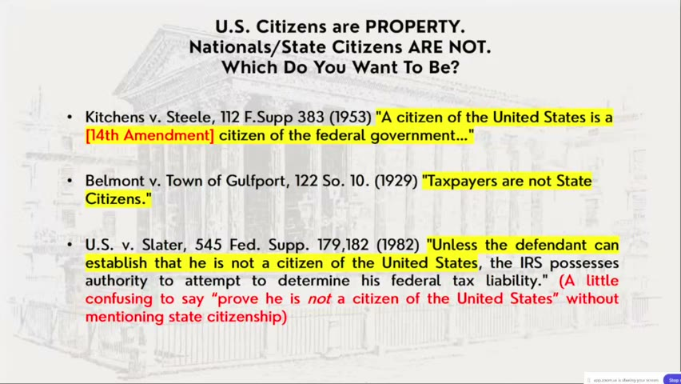
*Slide 8 [\[15:12\]](https://www.youtube.com/watch?v=v2N5ESMKI4g&t=904s): *[Kitchens v. Steele](https://www.courtlistener.com/opinion/1749268/kitchens-v-steele/)*, 112 F. Supp. 383 (1953) ("a citizen of the United States is a [[14th Amendment](https://constitution.congress.gov/constitution/amendment-14/)] citizen of the federal government"); *[Belmont v. Town of Gulfport](https://www.courtlistener.com/opinion/3390292/belmont-v-town-of-gulfport/)*, 122 So. 10 (1929) ("Taxpayers are not state citizens"); *[U.S. v. Slater, 545 F. Supp. 179](https://www.courtlistener.com/opinion/1431982/united-states-v-slater/)* (1982) (IRS has authority to determine tax liability "unless the defendant can establish that he is not a citizen of the United States"). The slide notes in red: "a little confusing to say 'prove he is *not* a citizen of the United States' without mentioning state citizenship."*

**Rhetorical question he poses:** if the Supreme Court has recognised state citizenship at least four times, "why have you never heard about" it in school?

---

## 5. Dialectics and the pre-Civil War republic [\[16:05–33:20\]](https://www.youtube.com/watch?v=v2N5ESMKI4g&t=957s)

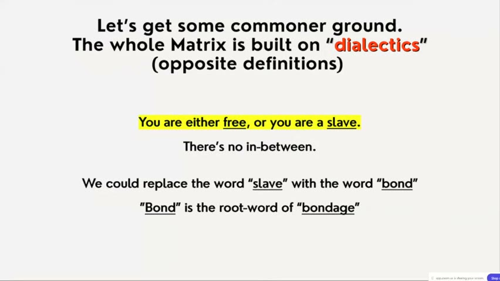
*Slide 9 [\[16:05\]](https://www.youtube.com/watch?v=v2N5ESMKI4g&t=957s): "The whole Matrix is built on 'dialectics' (opposite definitions)": "You are either free, or you are a slave. There's no in-between." "Slave" is swapped for "bond," root of "bondage."*

- Mentz says this is the one thing to take away: *dialectics runs the entire system.*
- He moves from the equivocation fallacy to [Black's Law Dictionary](https://thelawdictionary.org/)'s "dozens and dozens" of conflicting definitions of *person*.

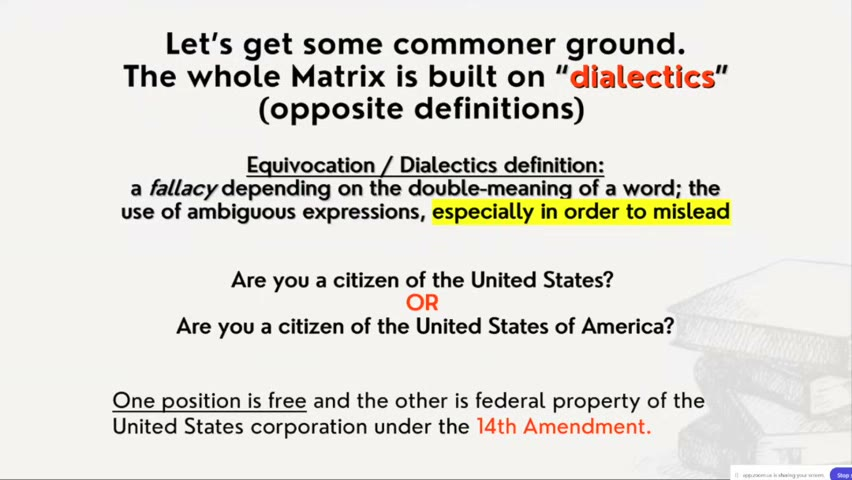
*Slide 10 [\[18:18\]](https://www.youtube.com/watch?v=v2N5ESMKI4g&t=1090s): Equivocation: "a fallacy depending on the double meaning of a word; the use of ambiguous expressions especially in order to mislead." "Are you a citizen of the United States? OR Are you a citizen of the United States of America?" "One position is free and the other is federal property of the United States corporation under the [14th Amendment](https://constitution.congress.gov/constitution/amendment-14/)."*

**Pre-Civil War America, as he describes it [\[19:10–22:30\]](https://www.youtube.com/watch?v=v2N5ESMKI4g&t=1142s):**
- Founded under common law ("no victim, no crime") and on individual sovereignty as a creation of the Creator. [The Bill of Rights](https://www.archives.gov/founding-docs/bill-of-rights-transcript) *enumerated* rights and did not grant them.
- No personal income tax until 1913, apart from Civil War greenbacks and Union Army taxation, and very little taxation overall. Yet there were "cities, roads, infrastructure, public transport, utilities," funded by excise taxes and imports.
- No licences, permits or certificates to travel or work. Cash could be redeemed in gold or silver at any bank.
- His rebuttal to "if you don't pay taxes, you shouldn't drive on the roads": how was it all built before 1913?

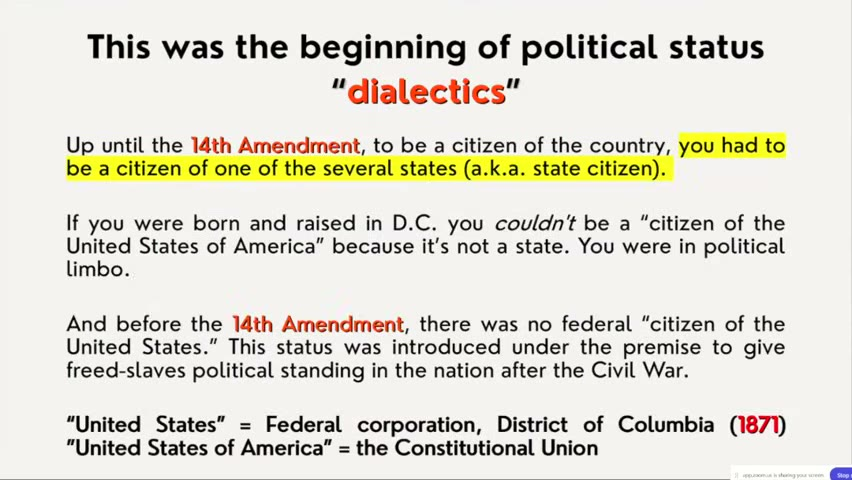
*Slide 11 [\[22:30\]](https://www.youtube.com/watch?v=v2N5ESMKI4g&t=1342s): "This was the beginning of political status 'dialectics'": before the [14th Amendment](https://constitution.congress.gov/constitution/amendment-14/) one had to be a citizen of a state to be a citizen of the country. Those born in D.C. before the Civil War "couldn't be a citizen of the United States of America because it's not a state." Before the [14th Amendment](https://constitution.congress.gov/constitution/amendment-14/) "there was no federal 'citizen of the United States,'" a status "introduced under the premise to give freed slaves political standing."*

- Each state had its own birth and naturalisation process. You were a citizen of Texas or Wyoming first, hence of the Union.
- The [14th Amendment](https://constitution.congress.gov/constitution/amendment-14/), he says, "was only designed to give freed slaves political standing". He later adds, in Q&A, that its first sentence was added "an hour before midnight" before ratification.
- **[Organic Act of 1871](https://www.govinfo.gov/content/pkg/STATUTE-16/pdf/STATUTE-16-Pg419.pdf).** He says the District of Columbia was formed into a corporation, "but they could only do that after the [14th Amendment](https://constitution.congress.gov/constitution/amendment-14/) because that established corporate federal citizenship."

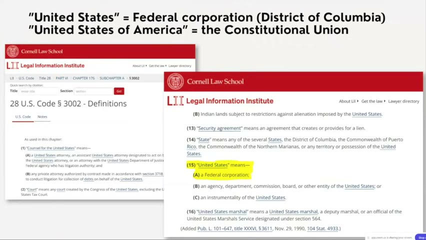
*Slide 12 [\[25:16\]](https://www.youtube.com/watch?v=v2N5ESMKI4g&t=1508s): "'United States' = Federal corporation (District of Columbia)"; "'United States of America' = the Constitutional Union." Shows [28 U.S.C. § 3002](https://www.law.cornell.edu/uscode/text/28/3002) (Cornell LII).*

Mentz points to **[28 U.S.C. § 3002](https://www.law.cornell.edu/uscode/text/28/3002), subsection (15)(A)**: "United States" "means a federal corporation." Points of emphasis:
- Quotation marks in a statutory definition mean "nothing can be added or subtracted." You cannot add "of America" to the term.
- Therefore "citizen of the United States" is a corporate status. "Whenever you see these words, think federal corporation."

---

## 6. The "national" definition and the escape clause [\[26:25–33:20\]](https://www.youtube.com/watch?v=v2N5ESMKI4g&t=1577s)

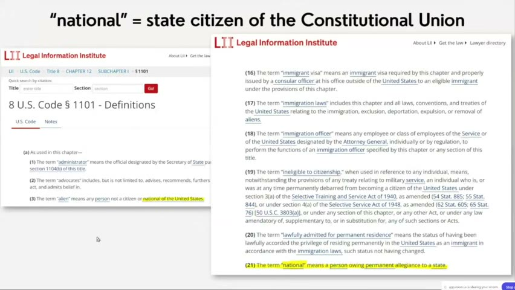
*Slide 13 [\[26:25\]](https://www.youtube.com/watch?v=v2N5ESMKI4g&t=1577s): "'national' = state citizen of the Constitutional Union," with [8 U.S.C. § 1101](https://www.law.cornell.edu/uscode/text/8/1101) on screen.*

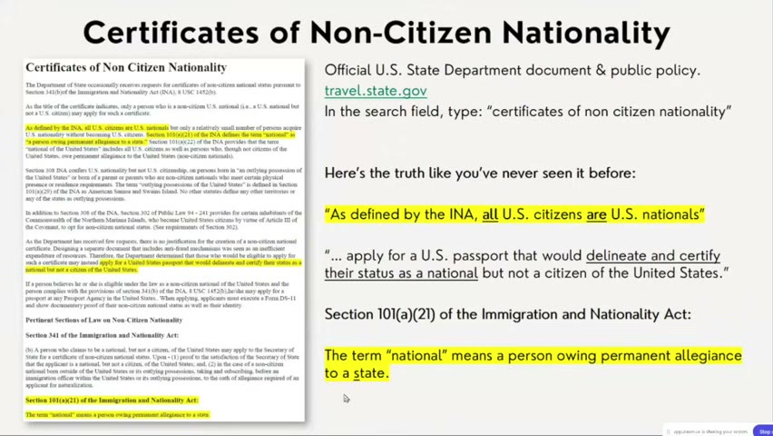
*Slide 14 [\[26:59\]](https://www.youtube.com/watch?v=v2N5ESMKI4g&t=1611s): "Certificates of Non-Citizen Nationality." State Department policy page (travel.state.gov): "As defined by the INA, **all U.S. citizens are U.S. nationals**"; applicants may get a passport that would "delineate and certify their status as a national but not a citizen of the United States." INA §101(a)(21): "The term 'national' means a person owing permanent allegiance to a state."*

**The argument, step by step:**
1. State Department policy says all U.S. citizens are U.S. nationals. Mentz asks why no one has ever asked "are you a U.S. national?"
2. The same page says one can apply for a passport certifying national-but-not-citizen status. The page itself addresses American Samoans and Swains Islanders, the only people the system labels "non-citizen nationals."
3. Mentz says the label "non-citizen national" does **not** apply to ordinary Americans. Instead, "they hid the pre-Civil War state citizen behind the American Samoan legislation" under a new dialectic label, hoping Americans would never ask what happened to the state citizen.
4. The definition says "a **state**" in lowercase. INA §101(a)(36) defines "State" with a capital S as including the District of Columbia, Puerto Rico, Guam and the Virgin Islands. "Even the capitalization of one single letter… can mean a whole world of difference." So a national is "owing permanent allegiance" to a *small-s state*, which is outside the capital-S "State" of D.C. and its territories.
5. **Jurisdiction and feudalism.** Jurisdiction "comes from the ancient feudal system," and the formula is "allegiance for protection, protection for allegiance." He calls today's system "a modern version of a corporate feudal system" and cites the Pledge of Allegiance.

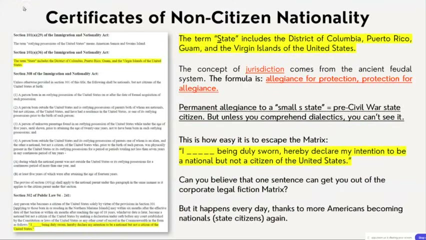
*Slide 15 [\[29:55\]](https://www.youtube.com/watch?v=v2N5ESMKI4g&t=1787s): Adds the "escape the Matrix" sentence from the policy page: "I, ____, being duly sworn, hereby declare my intention to be a national but not a citizen of the United States." "Can you believe that one sentence can get you out of the corporate legal fiction Matrix? But it happens every day, thanks to more Americans becoming nationals (state citizens) again."*

- Put this sentence into an affidavit and send it to the U.S. Secretary of State.
- Mentz says he has looked for holes "for all the years" and has found none. His view is that "reanimating the old republic" will come "from the bottom up."

---

## 7. The 14th Amendment, "the two questions," and the dual system [\[33:20–41:00\]](https://www.youtube.com/watch?v=v2N5ESMKI4g&t=1992s)

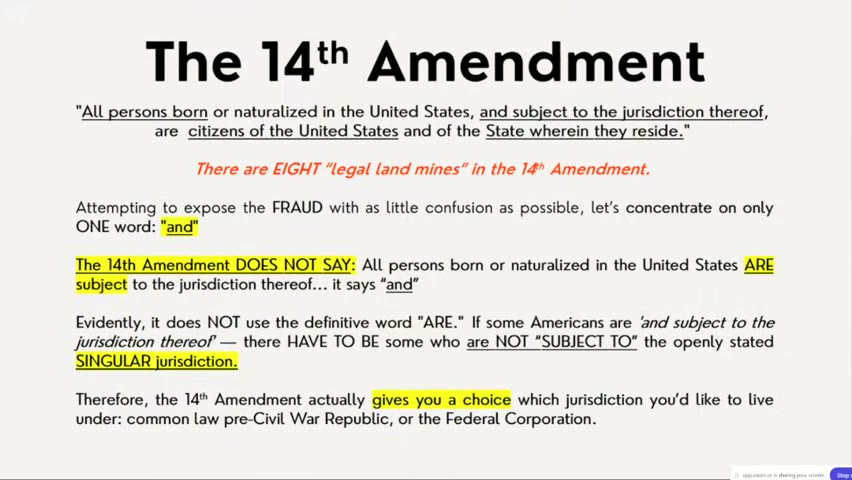
*Slide 16 [\[33:23\]](https://www.youtube.com/watch?v=v2N5ESMKI4g&t=1995s): "The [14th Amendment](https://constitution.congress.gov/constitution/amendment-14/)": "All persons born or naturalized in the United States, **and** subject to the jurisdiction thereof, are citizens of the United States and of the **State** wherein they reside." Notes "eight legal landmines," focuses on the word "and," and concludes "the [14th Amendment](https://constitution.congress.gov/constitution/amendment-14/) actually gives you a choice which jurisdiction you'd like to live under: common law pre-Civil War Republic, or the Federal Corporation."*

- The capital-S "State" in the amendment is "not a typo."
- His reading: the amendment does not say persons born or naturalised here *are* subject to the jurisdiction. It says "*and* subject." If some Americans are, others are not.
- In contrast, the [13th Amendment](https://constitution.congress.gov/constitution/amendment-13/) refers to "their jurisdiction," a collective jurisdiction of all the states. The 14th "all of a sudden… changes into a singular centralized jurisdiction."

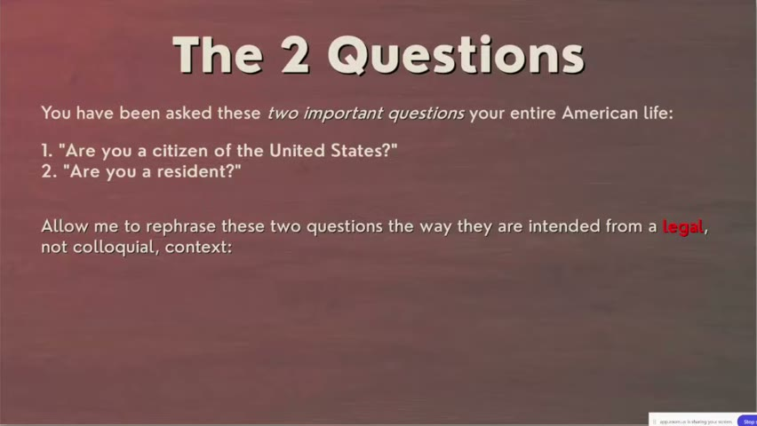
*Slide 17 [\[35:32\]](https://www.youtube.com/watch?v=v2N5ESMKI4g&t=2124s): "The 2 Questions": 1) "Are you a citizen of the United States?" 2) "Are you a resident?"*

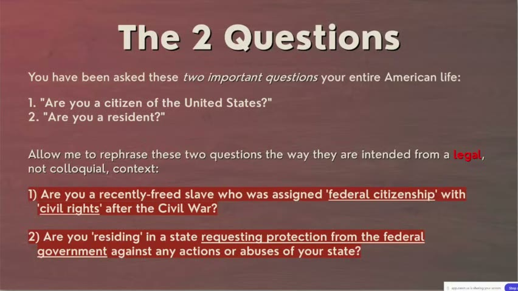
*Slide 18 [\[36:15\]](https://www.youtube.com/watch?v=v2N5ESMKI4g&t=2167s): Legal-context rephrasing: (1) "Are you a recently freed slave who was assigned 'federal citizenship' with 'civil rights' after the Civil War?" (2) "Are you 'residing' in a state requesting protection from the federal government against any actions or abuses of your state?"*

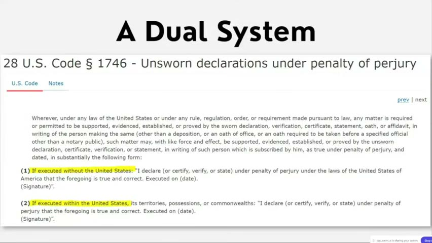
*Slide 19 [\[36:40\]](https://www.youtube.com/watch?v=v2N5ESMKI4g&t=2192s): "A Dual System": [28 U.S.C. § 1746](https://www.law.cornell.edu/uscode/text/28/1746), unsworn declarations under penalty of perjury.*

- [§ 1746](https://www.law.cornell.edu/uscode/text/28/1746) gives **two** declaration formulas: one for execution *outside* "the United States" ("under the laws of the United States of America") and one for execution *within* it ("its territories, possessions, or commonwealths"), where "of America" is omitted.
- Mentz's point: by default, anything signed under penalty of perjury falls into the **federal corporation** form. He says his students have written "United States of America" into contracts to choose the jurisdiction. "It's your choice."

---

## 8. Title 26: "non-resident alien" explained [\[41:00–44:10\]](https://www.youtube.com/watch?v=v2N5ESMKI4g&t=2452s)

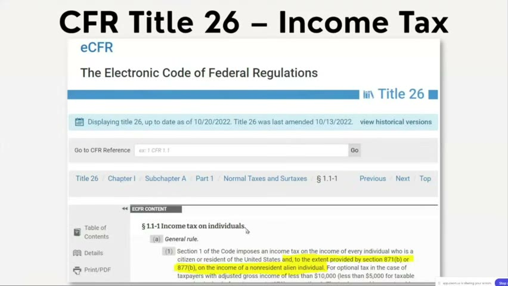
*Slide 20 [\[38:38\]](https://www.youtube.com/watch?v=v2N5ESMKI4g&t=2310s): "CFR [Title 26](https://www.law.cornell.edu/uscode/text/26) – Income Tax": [§ 1.1-1](https://www.law.cornell.edu/cfr/text/26/1.1-1), income tax "on individuals… who is a citizen or resident of the United States, to the extent provided by [section 871(b)](https://www.law.cornell.edu/uscode/text/26/871#b) or [877(b)](https://www.law.cornell.edu/uscode/text/26/877#b), on the income of a nonresident alien individual."*

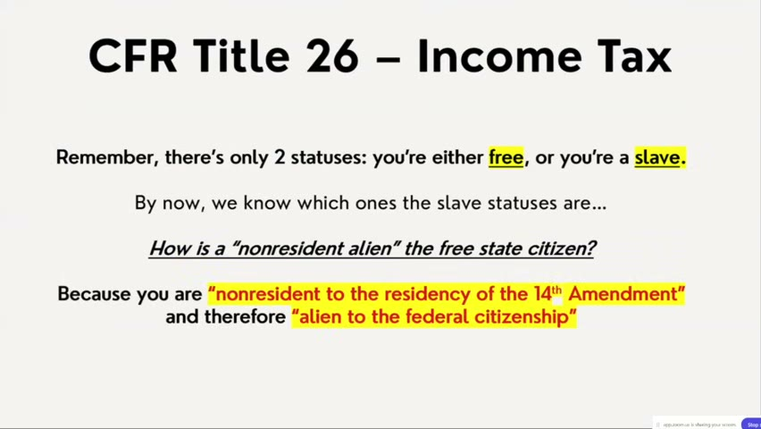
*Slide 21 [\[41:08\]](https://www.youtube.com/watch?v=v2N5ESMKI4g&t=2460s): "How is a 'nonresident alien' the free state citizen?" "Because you are 'nonresident' to the residency of the [14th Amendment](https://constitution.congress.gov/constitution/amendment-14/) and therefore 'alien' to the federal citizenship."*

- Mentz says the Code imposes tax on citizens and residents "of the United States," which lacks "of America" and so means the corporation.
- [§871(b)](https://www.law.cornell.edu/uscode/text/26/871#b) and [§877(b)](https://www.law.cornell.edu/uscode/text/26/877#b) cover the only two constitutional taxes before the Civil War: expatriation, and business within D.C. or proceeds from federally incorporated bonds (his example: Pacific Railroad bonds).
- "Non-resident alien" is "just another dialectic label." A state citizen is non-resident to the residency created by the [14th Amendment](https://constitution.congress.gov/constitution/amendment-14/) and alien to federal citizenship. "When you're a national you're no longer a resident, so whenever they ask you, just say no."

---

## 9. Benefits and drawbacks [\[42:02–44:05\]](https://www.youtube.com/watch?v=v2N5ESMKI4g&t=2514s)

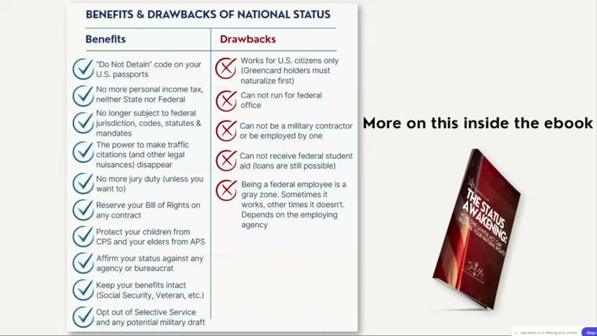
*Slide 22 [\[42:02\]](https://www.youtube.com/watch?v=v2N5ESMKI4g&t=2514s): "Benefits & Drawbacks of National Status."*

**Benefits as listed**
- "Do Not Detain" code on U.S. passports. Evidence offered: a sheriff on camera confirming it, and many member videos of police returning a passport card and releasing the member.
- No personal income tax, state or federal.
- No longer subject to federal jurisdiction, codes, statutes and mandates. The power to issue traffic citations, parking tickets and jury summonses "disappears."
- Reserve [Bill of Rights](https://www.archives.gov/founding-docs/bill-of-rights-transcript) on contracts; protect children from CPS and elders from APS; affirm status against any agency.
- **Keep benefits** (Social Security, veterans). "They're just a contract."
- Opt out of Selective Service and any potential draft.

**Drawbacks as listed**
- Works only for U.S. citizens. Green-card holders must naturalise first.
- Cannot run for federal office.
- Cannot be, or be employed by, a military contractor.
- Cannot receive federal student aid. Student *loans* are still possible.
- Federal employment is "a gray zone," depending on the agency.

---

## 10. "Real-life proof" [\[44:11–52:00\]](https://www.youtube.com/watch?v=v2N5ESMKI4g&t=2643s)

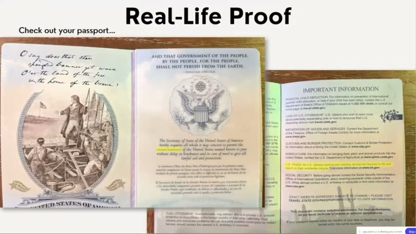
*Slide 23 [\[44:11\]](https://www.youtube.com/watch?v=v2N5ESMKI4g&t=2643s): "Check out your passport…" the front matter of a U.S. passport book.*

- Page 1 reads "The Secretary of State… hereby requests all whom it may concern to permit the **citizen/national**" to pass. It doesn't say "state national" or "American national."

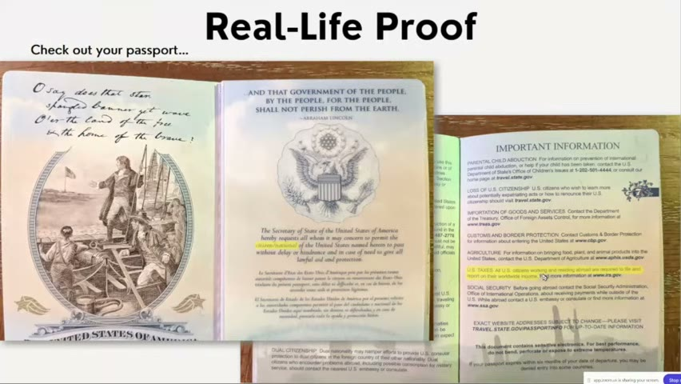
*Slide 24 [\[45:14\]](https://www.youtube.com/watch?v=v2N5ESMKI4g&t=2706s): Passport "Important Information" page.*

- That page says U.S. taxes apply to "all U.S. citizens working and residing abroad." Mentz notes it leaves out nationals, who "are not residing and… not required to file."

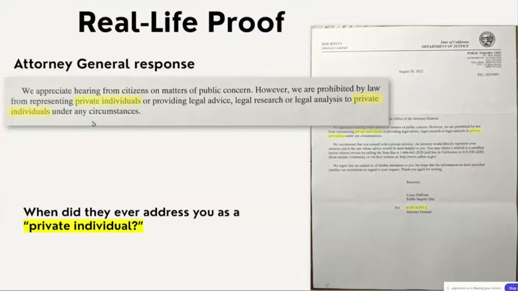
*Slide 25 [\[45:25\]](https://www.youtube.com/watch?v=v2N5ESMKI4g&t=2717s): California Attorney General reply: "We are prohibited by law from representing private individuals or providing legal advice…" Mentz asks: "When did they ever address you as a 'private individual'?"*

- Mentz reads the response as an admission that the sender is now in the "private" rather than the "corporate fictional" jurisdiction.
- He adds that after the [14th Amendment](https://constitution.congress.gov/constitution/amendment-14/), states had to adopt corporate versions of their constitutions, so every capital-S State is a "sub-corporation" of the D.C. corporation.

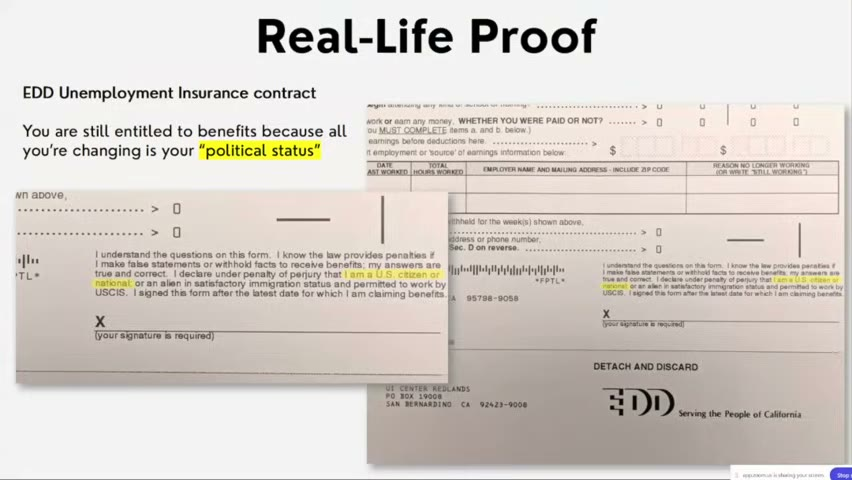
*Slide 26 [\[48:11\]](https://www.youtube.com/watch?v=v2N5ESMKI4g&t=2883s): California EDD unemployment-insurance contract: "I declare under penalty of perjury that I am a U.S. citizen or national." "You are still entitled to benefits because all you're changing is your 'political status.'"*

- A member applied and received unemployment. "Or" separates two distinct, equally valid statuses.
- He says the old republic "still exists… they just layered over top this federal corporation… it's a mirror."

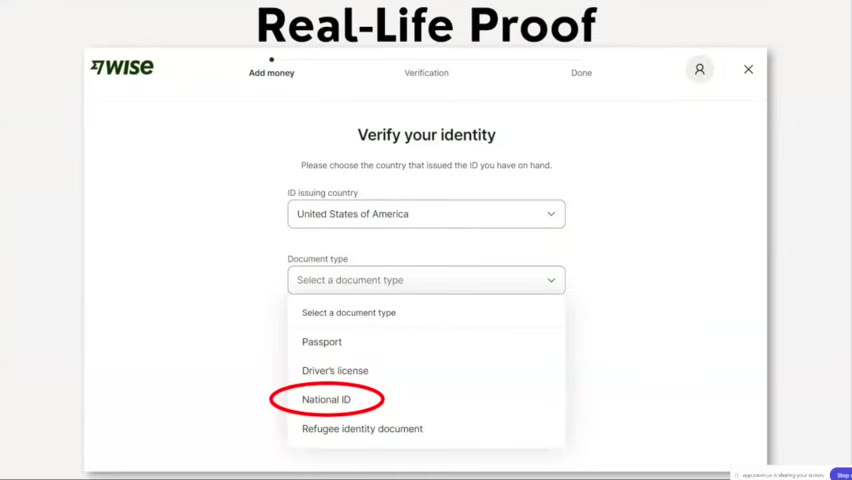
*Slide 27 [\[49:47\]](https://www.youtube.com/watch?v=v2N5ESMKI4g&t=2979s): Wise KYC: ID-issuing country "United States of America," document type "National ID" (circled).*

- Mentz selected "national ID," had it accepted, and treats this as a corporate acknowledgement of a "national" status.

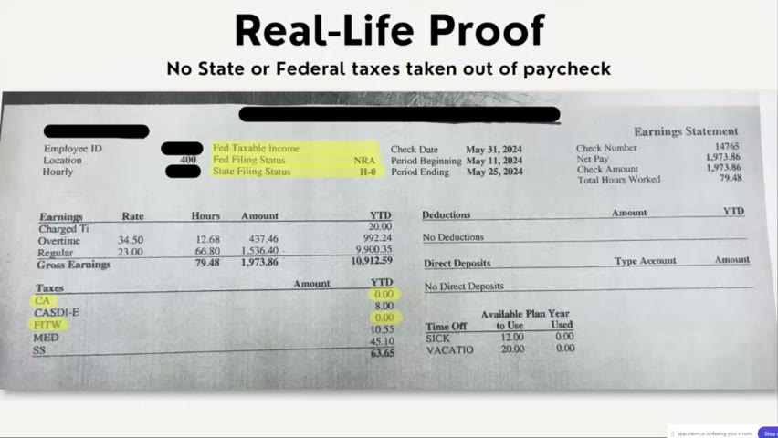
*Slide 28 [\[50:51\]](https://www.youtube.com/watch?v=v2N5ESMKI4g&t=3043s): Redacted pay stub: "No State or Federal taxes taken out of paycheck." Federal filing status "NRA," California tax $0, FITW (federal income tax withheld) $0.*

- The member chose to contribute to Medicare and Social Security. Others opt out of those too.

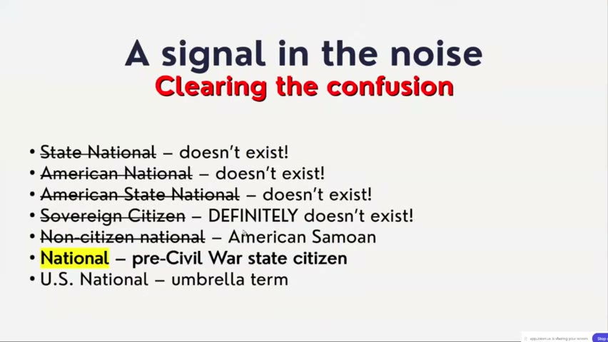
*Slide 29 [\[51:40\]](https://www.youtube.com/watch?v=v2N5ESMKI4g&t=3092s): "A signal in the noise. Clearing the confusion."*

| Term | Mentz's verdict |
|---|---|
| State National | doesn't exist |
| American National | doesn't exist |
| American State National | doesn't exist |
| Sovereign Citizen | "DEFINITELY doesn't exist" (a label "slapped on anyone trying to do anything different") |
| Non-citizen national | American Samoan only |
| **National** | **pre-Civil War state citizen** |
| U.S. National | umbrella term (can include U.S. citizens, non-citizen nationals and nationals) |

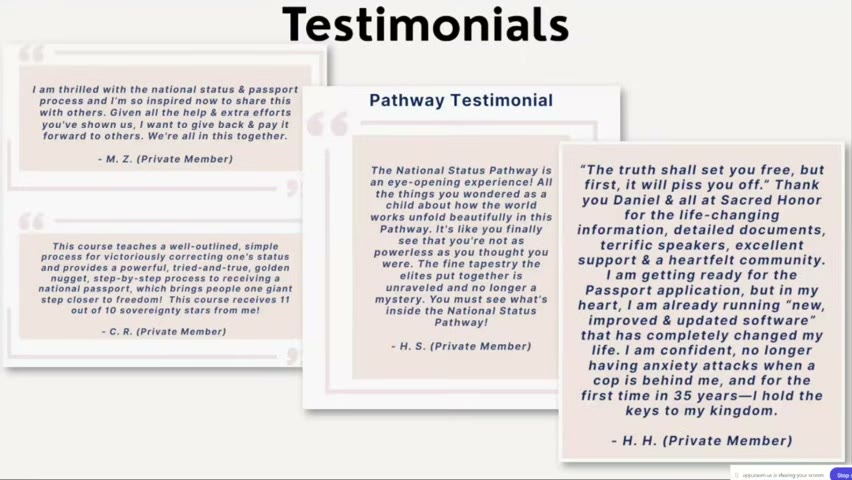
*Slide 30 [\[52:57\]](https://www.youtube.com/watch?v=v2N5ESMKI4g&t=3169s): Member testimonials (first set).*

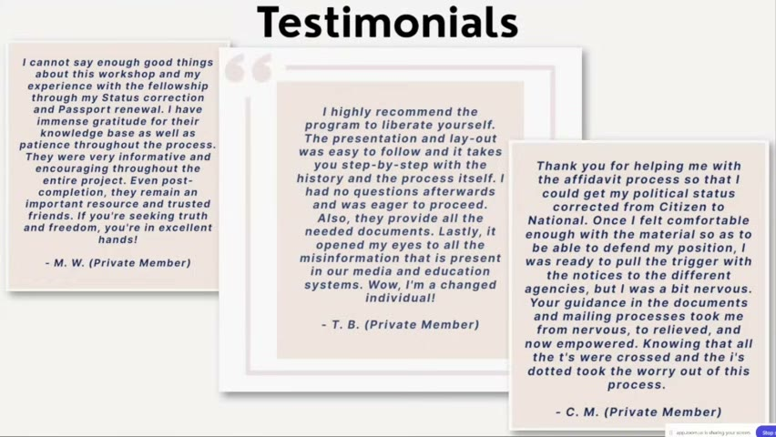
*Slide 31 [\[53:15\]](https://www.youtube.com/watch?v=v2N5ESMKI4g&t=3187s): Member testimonials (second set).*

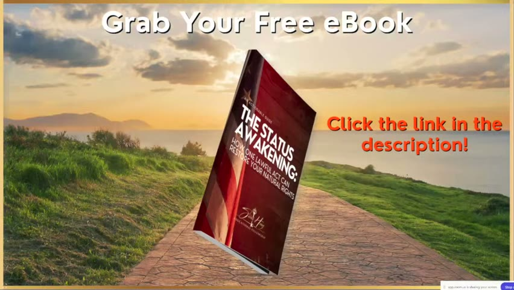
*Slide 32 [\[53:31\]](https://www.youtube.com/watch?v=v2N5ESMKI4g&t=3203s): "Grab Your Free eBook: *[The Status Awakening](https://www.sacredhonoref.com)*" (by the publisher, Sacred Honor Educational Fellowship). Link in the description / chat ([commonerlaw.com/national-status-welcome](https://www.commonerlaw.com/national-status-welcome)).*

---

## 11. Q&A [\[54:21–1:28:16\]](https://www.youtube.com/watch?v=v2N5ESMKI4g&t=3253s)

Host Griess reads submitted questions. Where it helps, the entry gives the questioner by first name only.

| Time | Question | Mentz's answer |
|---|---|---|
| [54:21](https://www.youtube.com/watch?v=v2N5ESMKI4g&t=3253s) | Reaction from host on "problem-reaction-solution"; did they plan the Civil War? | "International bankers" tried to subvert the republic through the 1800s by bribing officials and infiltrating legislatures; "the Civil War was their last resort." The [14th Amendment](https://constitution.congress.gov/constitution/amendment-14/)'s first sentence was added "an hour before midnight." |
| [56:21](https://www.youtube.com/watch?v=v2N5ESMKI4g&t=3373s) | Which U.S. Code titles do nationals remain subject to? | "None," except provisions naming nationals, and those are usually exemptions. A recent executive order on citizenship said its definitions follow the INA, which he reads as confirming "national = state citizen." He would like a FOIA on how many members of Congress are nationals "because none of them are paying income tax." |
| [58:25](https://www.youtube.com/watch?v=v2N5ESMKI4g&t=3497s) | Positive law vs. non-positive law | Positive law passes the House and Senate, is signed, and enters the Statutes at Large. The U.S. Code and CFR are "filtered, sliced and diced" and may lose their positive-law character or be inverted. "All that doesn't matter once you're a national." |
| [59:39](https://www.youtube.com/watch?v=v2N5ESMKI4g&t=3571s) | TSA | An unsolved item: express lines for nationals existed and were removed. "Whenever they remove something they have to keep the remedy in place," so students are working on it. He describes members as "national pioneers." |
| [1:01:28](https://www.youtube.com/watch?v=v2N5ESMKI4g&t=3680s) | Withholding opt-out, but the IRS still says she owes | Withholding forms don't change the IRS's view of liability. The fix is to "rinse and repeat your documents." An IRS "invitation" to file is just an offer to re-contract: "nope, thanks, I'm still a national." The host adds: "look out for attempts to recontract." |
| [1:02:51](https://www.youtube.com/watch?v=v2N5ESMKI4g&t=3763s) | DS-11 vs. DS-82 for the do-not-detain list? | Either. "It's not the form… it's what's on file with the U.S. Secretary of State." Step 1: notarise the affidavit and send it to the Secretary of State. Step 2: apply or renew with the affidavit attached. Both forms carry the same oath. |
| [1:04:56](https://www.youtube.com/watch?v=v2N5ESMKI4g&t=3888s) | Comparison with another outfit (Copper Moonshine) | "We actually are using most of their technique, but we refined it." Its limitation, in his view: it changes status only on the passport. The processing centre won't enter it into the wider system, so it doesn't help with the IRS, county or state. His process "stands on the affidavit," which can go to anyone. Anyone challenging it would need a counter-affidavit under penalty of perjury. "We've never seen anyone do it." |
| [1:07:07](https://www.youtube.com/watch?v=v2N5ESMKI4g&t=4019s) | Biometrics at airports | "I don't think they can make it universal here because we're in a **voluntary feudal system**." Keep a question in your pocket: "Is this mandatory or voluntary?" |
| [1:08:30](https://www.youtube.com/watch?v=v2N5ESMKI4g&t=4102s) | (Mentz, on opt-outs) | "There's always a way out." Examples: the 508(c)(1)(A) church exemption, and debt discharge under the [1933 Emergency Banking Act](https://www.govinfo.gov/content/pkg/STATUTE-48/pdf/STATUTE-48-Pg1.pdf). He suggests the system's designers keep these exits to "stay karmically clean," so the two questions are about obtaining *consent*. |
| [1:11:10](https://www.youtube.com/watch?v=v2N5ESMKI4g&t=4262s) | Does the passport look different? Stars? | No physical difference. Stars on the passport card are irrelevant: people with three, four and five stars all got released. There are no stars on the book. What matters is what is on file with the Secretary of State, backed by an 1835 Supreme Court decision (not named in the talk) holding it the "highest and best evidence" of standing. |
| [1:13:39](https://www.youtube.com/watch?v=v2N5ESMKI4g&t=4411s) | Free travel: does the vehicle code apply? Registration? Licence? | "Technically yes [it no longer applies], but the cops will not agree." Options by comfort level: show the passport card; some drive with no plate or a homemade plate (more stops; about 5% of officers "on a power trip" may tow). **His recommendation:** non-resident Montana plates, with no smog or inspection, permanent plates for cars over ten years, and a passport accepted as ID. He was pulled over in California for tint and a missing front plate and could not be cited because the car was Montana-registered. |
| [1:17:05](https://www.youtube.com/watch?v=v2N5ESMKI4g&t=4617s) | Veterans' benefits | "You keep them." No repercussion. |
| [1:17:25](https://www.youtube.com/watch?v=v2N5ESMKI4g&t=4637s) | A manager at the Secretary of State asked why the passport should look different | What changes is "the information that's programmed into your passports," which law enforcement and TSA see only in limited form. A TSA agent showed him a screen with name, photo, expiry and a green "valid" bar. |
| [1:18:36](https://www.youtube.com/watch?v=v2N5ESMKI4g&t=4708s) | Independent contractor status | Not military contractor. State and county contracting are "a gray zone," workable for some. He says nationals need not disclose status. For independent contractors "it's not a [W-4](https://www.irs.gov/forms-pubs/about-form-w-4)," so there is nothing to mark exempt. |
| [1:19:46](https://www.youtube.com/watch?v=v2N5ESMKI4g&t=4778s) | Children | Both parents must become nationals first. A "children's affidavit" template is signed by both, then it is sent to the Secretary of State, followed by a passport application. Both parents must attend the child's passport appointment, or the parent with full custody. Where only one parent agrees it is "really tricky" and untested. |
| [1:21:40](https://www.youtube.com/watch?v=v2N5ESMKI4g&t=4892s) | Course support | Email support; a monthly one-hour membership call with a topic and often a success story; private one-on-one calls. **Success story** shared: a member (October of the previous year) "shut down the whole traffic court"; 40-plus cases were dismissed after she stated her status three times, the last before the judge. |
| [1:23:17](https://www.youtube.com/watch?v=v2N5ESMKI4g&t=4989s) | Existing contracts | Not needed. One affidavit version includes language disavowing prior contracts that conflict with the new status. Mostly employment paperwork needs updating. |
| [1:24:18](https://www.youtube.com/watch?v=v2N5ESMKI4g&t=5050s) | If pulled over, what to say? | A script based on equity: ask questions, make no statements ("he who makes a statement has the burden of proof"). Some tape the questions inside the door. Keep it simple: hand over the passport card; "say as little as possible"; invoke the [Fifth Amendment](https://constitution.congress.gov/constitution/amendment-5/) or *Miranda*. He does not advocate going without insurance, though some nationals carry only a passport card. |
| [1:26:20](https://www.youtube.com/watch?v=v2N5ESMKI4g&t=5172s) | Incarcerated people | He has not dealt with it. Logistics (notarisation, certified mail) look hard. "Two witnesses" is a biblical alternative to notarisation. He says the equity pathway is likelier suited to victimless offences ("discharge the commercial value of the sentence"). |

---

## 12. The course and the four pathways [\[1:28:16–1:32:30\]](https://www.youtube.com/watch?v=v2N5ESMKI4g&t=5288s)

**Course structure (his description)**
- Five main video modules, about five hours, in a voice-over presentation style.
- Bonus modules: completing and filing the passport application; lawful travel.
- An archive of a year of monthly membership-call replays.
- Three main Q&A modules.
- 20–30 hours of material in total, plus a resources section: essential templates and bonus templates for people with LLCs, S-corps, employment or contracting.
- Self-paced. "By no means a stale, once-and-done kind of deal."

**The four pathways**
1. **National Status & Passport** (this talk).
2. **Land patents** ("loading of land"): "how we take back our land, the soil."
3. **Equity pathway:** discharging public obligations (debts, credit cards, mortgages). "Very difficult, not impossible… the banks are going to fight you."
4. **The "trifecta" trust model:** a free church (508(c)(1)(A)) + a trust + PMAs (private membership associations), integrated "so that everything becomes an extension of the church." Rationale: religion is "mandatorily exempted" from the commercial system under the Establishment Clause. Public-facing LLCs and S-corps can be owned by the trust, which the church owns.

---

## 13. Close [\[1:32:30–1:35:43\]](https://www.youtube.com/watch?v=v2N5ESMKI4g&t=5542s)

- Griess's slogan: **"Be free and act like it."**
- John Cacero, a long-time Sayles associate and the person who introduced Mentz to Sayles, commends Mentz for taking the Sayles information and doing "an absolutely astounding job in clarifying it and presenting it." Mentz thanks him and says it was "the beginning of life number two for me."

---

## 14. Claims worth checking before reliance

These are observations for a public reader, not rebuttals.

1. **[28 U.S.C. § 3002](https://www.law.cornell.edu/uscode/text/28/3002) definitions** begin with "As used in this chapter" and belong to [the Federal Debt Collection Procedures Act](https://www.law.cornell.edu/uscode/text/28/part-VI/chapter-176). The talk treats subsection (15)(A) as a general definition of "United States." The text of [§ 3002(15)](https://www.law.cornell.edu/uscode/text/28/3002#15) should be read in full.
2. **The [14th Amendment](https://constitution.congress.gov/constitution/amendment-14/)'s text** reads "…and subject to the jurisdiction thereof, are citizens of the United States and of the State wherein they reside." The talk's emphasis is on "and" and on capital-S "State." Case law interpreting the Citizenship Clause is not discussed.
3. **[8 U.S.C. § 1101(a)(21)](https://www.law.cornell.edu/uscode/text/8/1101#a_21)** does define "national" as "a person owing permanent allegiance to a state," as the slide shows. A separate definition, [§ 1101(a)(22)](https://www.law.cornell.edu/uscode/text/8/1101#a_22), defines "national of the United States" (a citizen, or a person owing permanent allegiance to the United States). The talk's reading of lowercase "state" as the pre-Civil War state citizen, and of the capital-S "State" definition in [§ 1101(a)(36)](https://www.law.cornell.edu/uscode/text/8/1101#a_36), is Mentz's interpretation. The statute does not itself say so.
4. **The case quotations** are given from slides. Note that *[Madden v. Kentucky](https://www.law.cornell.edu/supremecourt/text/309/83)* (1940), which the deck cites for "natural rights inherent in state citizenship," is generally understood to have overruled *[Colgate v. Harvey](https://supreme.justia.com/cases/federal/us/296/404/)* (1935), which the deck cites just before it; whether the quoted passages still carry the weight claimed is worth checking. *[Jones v. Temmer](https://law.justia.com/cases/federal/district-courts/FSupp/829/1226/1876934/)* and *[U.S. v. Valentine](https://www.courtlistener.com/opinion/1641873/united-states-v-valentine/)* are lower-court (F. Supp.) citations, and the exact wording and context should be confirmed in the reporters. On 2026-11-22 the opinion pages were read for the quoted passages: the *[Jones v. Temmer](https://law.justia.com/cases/federal/district-courts/FSupp/829/1226/1876934/)*, *U.S. v. Valentine* and *U.S. v. Slater* quotations are present in their opinions. For *[Kitchens v. Steele](https://www.courtlistener.com/opinion/1749268/kitchens-v-steele/)* the opinion reads "A citizen of the United States is a citizen of the federal government and at the same time a citizen of the state in which he resides"; the deck's version inserts "[[14th Amendment](https://constitution.congress.gov/constitution/amendment-14/)]" and stops before the second half. The sentence "Taxpayers are not state citizens" was **not found** in the *[Belmont v. Town of Gulfport](https://www.courtlistener.com/opinion/3390292/belmont-v-town-of-gulfport/)* opinion, which concerns whether a non-taxpaying citizen could intervene in a Florida bond-validation suit.
5. **The "do not detain" code, the 1835 Secretary-of-State case and the success stories** are presented via anecdote, a video the audience does not see in this recording, or unnamed authority. No citation is given for the 1835 case.
6. **Outcomes are anecdotal.** The talk contains no independent evidence of how often police, the IRS or courts respond as described.