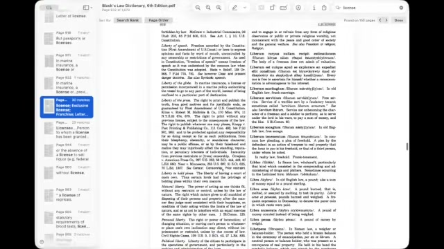
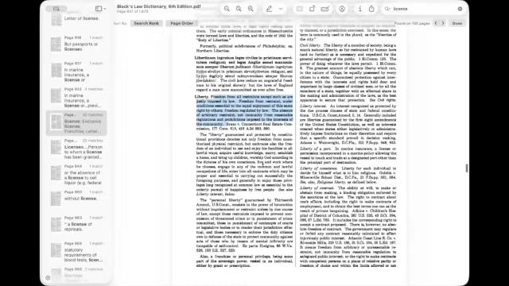
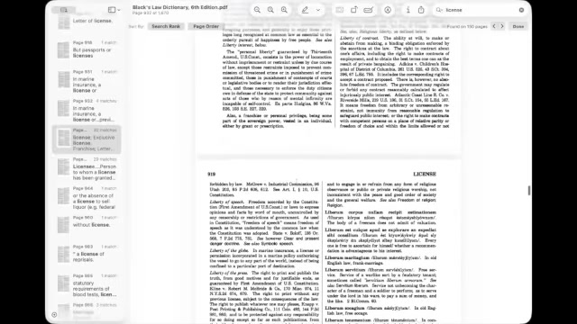
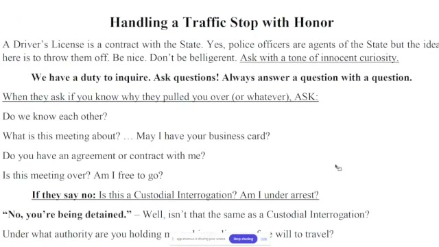
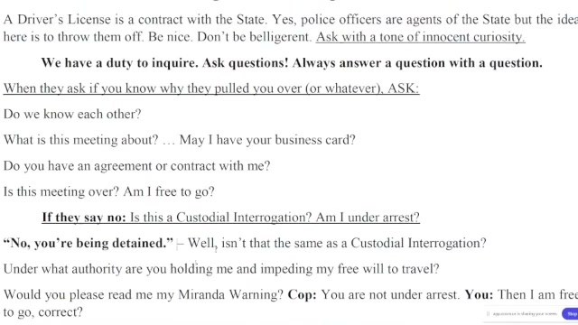
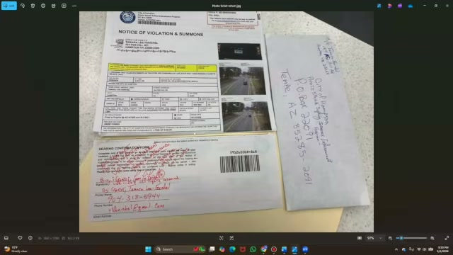

# Daniel Mentz on National Status, Passports, and the Right to Travel

| | |
|---|---|
| **Queue title** | Commoner | Daniel Mentz on National Status, Passports, and the Right to Travel |
| **Video** | [YouTube: _-LTnN5BeBs](https://www.youtube.com/watch?v=_-LTnN5BeBs) · 1 h 43 m 44 s · published 2026-05-11 by Commoner Law Group |
| **Event** | Free Traveler Monthly Confab (Commoner Law Group's monthly right-to-travel call) |
| **Presenter** | Daniel Mentz, Sacred Honor Educational Fellowship (National Status & Passport Pathway) |
| **Host** | Clint Griess, Commoner Law Group |
| **Format** | Conversation and Q&A with audience members who join on camera. Only a few screen-shares; most of the video is gallery view. |
| **Queue row ID** | `f6a743f9-8750-46a0-a76f-16db47bda42a` |
| **Collateral** | [Full transcript](collateral/transcript.md) · [video metadata](collateral/video-metadata.json) · [slide index](slides/slides-index.md) |

Every timestamp is a link that opens the video about 8 seconds before the stated time, so you have a moment to get ready.

> **Reader's note.** This summarises what is said on the call. The legal claims are the speakers' own and were not verified here. They are mostly practical claims about traffic stops, court procedure and financial instruments. The closing "Claims worth checking" section lists points to check before relying on any of them. Nothing here is legal advice.

---

## 1. Thesis in brief

The call applies "national status" (see [interview 01](../01.national_status_and_passport/summary.md)) to the right to travel. Mentz's position is that:

1. A driver's licence is a **contract** with the state, so a person who has stepped out of the "citizen/resident" status has choices about whether to keep it, how to hold it, and how to respond to a citation.
2. A traffic citation is a **commercial instrument**. Courts are, in his view, commercial venues running on bonds and accounting. So the most effective responses are questions about **jurisdiction** and about the **financial/banking side** of the case, not arguments about traffic law.
3. At the roadside the approach is **honor and innocent curiosity**: ask questions, do not argue, do not try to educate the officer, and if the situation becomes dangerous, comply and "deal with the paper later in the comfort and safety of your home."
4. When a citation or charge does arrive, remedies exist. For nationals that means the status paperwork. For everyone it means **equity**, which he says "settles and closes the accounting" rather than arguing the charge.

Throughout, Mentz stresses there is "no silver bullet," that outcomes vary by officer and court, and that nationals are not licensed to ignore genuine safety rules.

---

## 2. Host's framing [\[00:00–08:50\]](https://www.youtube.com/watch?v=_-LTnN5BeBs&t=0s)

- Griess opens with the right to travel as "a God-given right to go from place to place without asking the permission of the government," and traffic enforcement as "a revenue generating scheme."
- He recommends Commoner's video "[The Secret Financials of the Justice System](https://www.youtube.com/watch?v=P_c5BJq3EeE)" (posted by Commoner Law Group as "The Secret Financials Underlying Our Justice System with Todd Duell"). Its claim, as he summarises it, is that a court file number is converted into a financial instrument traded on markets and that "we Americans have been pledged as security for the national debt."
- His point: "what we need to learn before even the law is accounting."
- He asks audience members to share first-hand stories (tickets sent back as an "offer to contract," courtroom challenges, results) and introduces Mentz, who is returning after the full presentation in interview 01.

---

## 3. Mentz's opening: choices, courts and commercial instruments [\[08:52–17:45\]](https://www.youtube.com/watch?v=_-LTnN5BeBs&t=524s)

**"Yes and."** Asked whether a national's life differs on the road, Mentz says the answer to each question is "a yes and," because national status "gives you the freedom of choice." Nationals variously:
- keep a driver's licence, for work or other reasons,
- surrender it through a specific process,
- keep vehicles registered where they live,
- or use non-resident plates (he names South Dakota and Montana).

**Two aspects of getting a citation dismissed.** He is recording an extra module for the National Status & Passport Pathway on the steps. Key points:
- Traffic courts are "entry-level bulldogs." Some of the time the person on the bench is a **commissioner** rather than a judge, with no oath to uphold the Constitution, "just there to administer the commercial aspect of this transaction."
- "Everything has been turned commercial since 1938, technically since 1933." He cites *[Erie Railroad v. Tompkins](https://supreme.justia.com/cases/federal/us/304/64/)* (1938) as collapsing all forms of law in the courts, so "all the layers of law still exist within every single court" and it is up to each person "to bring back the layer that you want to have recognized."
- He cites [Black's Law Dictionary](https://thelawdictionary.org/) (fourth edition onward) for "custom supersedes common law," so courtroom customs harden into law, and bringing common law in "is not impossible… but you really have to know what you're doing."

**The ticket as negotiable instrument.** Because the citation is "a commercial instrument… a negotiable instrument":
- some jurisdictions need your signature, others treat the licence or registration as the "jurisdictional nexus,"
- every case has bonds attached: an **appearance bond**, then **bid, performance and settlement bonds**, which "get turned into security instruments that the judge has to sign,"
- these are "packaged into other banking products," giving the case up to "90 times" its face value, so a $250 ticket is "worth" $22,500 to the system.

**His practical conclusion.** "The most effective way we found is we basically asked them questions about the **jurisdictional aspect**… and secondly about the **banking aspect**." These are "two very uncomfortable topics" the court "can't answer and doesn't want to answer," and cases "get dismissed more easily."

---

## 4. License versus liberty [\[17:46–22:00\]](https://www.youtube.com/watch?v=_-LTnN5BeBs&t=1058s)

*Slide 1 [\[20:50\]](https://www.youtube.com/watch?v=_-LTnN5BeBs&t=1242s): [Black's Law Dictionary](https://thelawdictionary.org/), 6th edition (PDF), the entries for liberty and license, shared by Mentz.*

*Slide 2 [\[21:33\]](https://www.youtube.com/watch?v=_-LTnN5BeBs&t=1285s): The "Liberty" definition highlighted ("freedom from restraint…").*

*Slide 3 [\[21:52\]](https://www.youtube.com/watch?v=_-LTnN5BeBs&t=1304s): The "License" entry and the neighbouring pages.*

- A **license**, per Black's, is "the ability to do something that would otherwise be illegal."
- The Constitution "doesn't say anything about needing a license or permits." Almost every state supreme court has issued right-to-travel decisions. Pre-Civil War, "if you were a private individual, a private state citizen, then there was no license… you didn't have to ask permission."
- After the Civil War, and especially in the 1930s, everything was turned into "a privilege rather than a right… and trick people into voluntarily applying for the benefits of a privilege rather than standing in the right that they already have."
- **Constitution vs. natural rights.** "The Constitution doesn't give you any rights." [The Bill of Rights](https://www.archives.gov/founding-docs/bill-of-rights-transcript) "enshrined that which you already have." "Constitutional rights," in his view, means 14th-Amendment civil rights "given to you by a government and can be taken away."
- A legal-thesaurus synonym for **liberty is "locomotion,"** "the right to move yourself and your personal property from A to B without encumbrance."
- Griess notes that in Black's sixth edition the entry for *liberty* is followed immediately by *license*. He frames the Commoner approach as informing people so they can make their own risk/reward choices.

---

## 5. Making a licence more private [\[22:43–32:00\]](https://www.youtube.com/watch?v=_-LTnN5BeBs&t=1355s)

Griess asks what a licence-renewal notice looks like to a national. Mentz says some people need a licence for their job, so "there are ways you can make your driver's license a lot more private and reserve your rights on it." He describes what **he tested himself** (the fellowship brings nothing forward "unless we actually test it") and adds the standard disclaimer that this is information and entertainment only.

**What he did (Southern California, in-person renewal):**
1. Booked an in-person renewal and asked at the check-in counter to **update his picture**, because the signature is only captured at the photo step.
2. On the check-in terminal, to "Are you a U.S. citizen?" he chose **"prefer not to answer"** (options were yes, no, prefer not to answer). The residency question did not follow.
3. Gave a **private mailbox** address, entered as an "apartment building," because PO boxes are not accepted.
4. At the signature pad, wrote "**under duress**" in cursive instead of his name. "No one said anything."
5. He chose a **non-REAL ID** licence. A member in a state that no longer offers one reportedly spent two to three hours and escalated to a supervisor before getting a non-REAL ID renewal and unenrolling from REAL ID.

**What this does and does not do.** "It's more confidential," not a release: "it's still technically a contract with the state." Writing *under duress* does not void a contract signed under duress; writing "**void**" would be different, "a little hint" for traffic citations. **Rescission** is the equitable remedy to sever the licence contract outright (surrendering the licence), but "you don't want to give up your driver's license unless you absolutely know what you're getting into."

An audience member mentions signing below the signature "by agent" or with a UCC reference. Mentz notes that the officer "is not privy to any of this conversation."

---

## 6. The traffic stop "with honor" [\[33:00–48:00\]](https://www.youtube.com/watch?v=_-LTnN5BeBs&t=1972s)

*Slide 4 [\[37:20\]](https://www.youtube.com/watch?v=_-LTnN5BeBs&t=2232s): Mentz's one-page script, "Handling a Traffic Stop with Honor."*

**Posture.**
- "Having a national status and passport is **not a license to be an a-hole**." He does not want people to become nationals to speed, ignore safety, or race.
- Many traffic rules "have their foundation in common law" (his example is the four-way stop and first-to-arrive right of way). The commercialised ones (window tint, front plates) are "ridiculous."
- Griess pushes back that any car moving at speed is dangerous. Mentz says he is focused on the ~99% of stops with no harm and no emergency.
- Approach from honor: "honor yourself, honor the police and honor the system at large," because "the system actually gives you all the remedy you need, they just never told you about it." Be peaceful and "don't be belligerent." Officers are trained to treat loud people as threats.

**The script (all questions, no statements; "equity: a duty to inquire"):**

*Slide 5 [\[43:44\]](https://www.youtube.com/watch?v=_-LTnN5BeBs&t=2616s): The same page scrolled to its end, with the Miranda exchange.*

| Step | Say (as questions) |
|---|---|
| 1 | When asked "do you know why I pulled you over": "Do we know each other?" |
| 2 | "What is this meeting about?" (optionally: "May I have your business card?" He wants the officer's card to put them on notice later.) |
| 3 | "Do you have an agreement or contract with me?" |
| 4 | "Is this meeting over? Am I free to go?" |
| 5 | If they say no: "Is this a custodial interrogation? Am I under arrest?" |
| 6 | If "No, you're being detained": "Isn't that the same as custodial interrogation? Under what authority are you holding me and impeding my free will to travel?" |
| 7 | "Would you please read me my Miranda warning?" The officer answers "You are not under arrest." Then: "Then I am free to go, correct?" |

Mentz says this "usually ends right here," while acknowledging "bad apples" who write a ticket regardless. He says it is designed to "diffuse and disarm." He adds that "cops are being trained on reading energy about someone's intent" and that "he who asks the questions is in power."

**Handing over ID.** The questions come first. If pressed, give the **passport card** (even a driver's licence is acceptable). Members' reports he relays:
- A national gave the card, the officer asked "is this some kind of right-to-travel thing?", handed it back and said "have a nice day."
- One member was stopped five times in a year and released each time.
- In "extremely rare" cases an officer has kept a passport card. That is why questions come first.

**Griess on enforcement trends.** Some states reportedly now make it mandatory to hand over licence, registration and insurance before the officer explains the stop, and officers use force to extract it. This "causes a wrinkle" in the strategies discussed.

---

## 7. Role-play and listener experiences [\[48:10–1:09:00\]](https://www.youtube.com/watch?v=_-LTnN5BeBs&t=2882s)

**Role-play [\[49:47–55:23\]](https://www.youtube.com/watch?v=_-LTnN5BeBs&t=2979s).** An audience member (Casey) plays the officer (registration-tag stop). In the exchange:
- The "officer" ignores the questions, says he needs "that number from the DMV" and threatens arrest.
- Mentz asks whether this is a custodial interrogation, asks for Miranda, and hands over the passport card. The "officer" says it has no number, and Mentz asks him to run it by name and birth date.
- Mentz explains the ideal: the system shows "**do not detain**." He cites a video of a sheriff confirming that code and says some officers, knowing what will appear, don't run the card and write the ticket anyway: "it's such a dynamic wild west."

**Casey's real stop [\[55:23–57:45\]](https://www.youtube.com/watch?v=_-LTnN5BeBs&t=3315s).** A California Highway Patrol officer needed "that number," ultimately accepting an old registration, which Casey then used to beat the ticket. Mentz: the licence number is the individual contract, so "jurisdiction is there"; without it the officer's case may be harder.

**Tamara (Virginia) [\[57:45–1:09:45\]](https://www.youtube.com/watch?v=_-LTnN5BeBs&t=3457s).**
- Explains the passport **card** (domestic use, requested on the same application as the book).
- Holds an "American state national" credential and a Virginia licence marked "federal limits apply." Mentz says he can't speak to that method: "we go the route of the official passport attaching an affidavit," which produces credentials "encoded with this do not detain code." Law enforcement "only see a code that tells them what to do or not to do with you."
- He says what is in the **administrative file** at the State Department is "the highest and best evidence" of standing. That is the first step, the "citizenship evidence affidavit."
- She shows a **photo-ticket** from Hampton, Virginia (payments directed to Washington State, hearing request to Arizona) as proof of a "foreign corporation" and says she returned it in red ink: "no contract, no jurisdiction, unjust enrichment, special appearance," with "in person" struck through and her signature qualified as "grantor… with all rights."

*Slide 6 [\[1:05:43\]](https://www.youtube.com/watch?v=_-LTnN5BeBs&t=3935s): The photo-enforcement notice and her annotated reply.*

---

## 8. Hard cases from the audience [\[1:09:00–1:25:00\]](https://www.youtube.com/watch?v=_-LTnN5BeBs&t=4132s)

**Faye (Texas) [\[1:09:45–1:19:00\]](https://www.youtube.com/watch?v=_-LTnN5BeBs&t=4177s).** Arrested within seven minutes after complying with an order to get out (dog in the car). The sheriff read her status paperwork and released her. A second county threatens a warrant if she doesn't plead by 13 May, and courts are returning mail sent to P.O. boxes.
- Mentz's advice: **certified mail** is, by postal codes, "considered to be received and… filed" even at a PO box. Put the **case number on the outside of the envelope** so it is routed to the right clerk. "You don't have to serve them," because "you serve summons" and an individual can't serve a summons on a court.
- He says the USPS can be treated as "a court of record" for chain of custody.

**Arlen (Australia): why do police ask you to step out?** [\[1:18:34\]](https://www.youtube.com/watch?v=_-LTnN5BeBs&t=4706s). "Now you have abandoned your property… easier to seize it." One untested idea he has heard: ask "is this a request or an order?" His firm advice: if it escalates, "comply and say, *I will now comply with your demands because I'm in fear of my life. I am under duress.*" "**Do not argue with the cops. Do not try to educate them on the law.** … that makes you belligerent and aggressive and you will be treated as such." He recalls someone who was shot for arguing and says the paper can be handled "in the comfort and safety of your home," "even if you have to use equity."

**Irv (Delaware) [\[1:21:00–1:33:00\]](https://www.youtube.com/watch?v=_-LTnN5BeBs&t=4852s).** Three years earlier he put his window down two inches and said "I plead the Fifth and [Sixth Amendment](https://constitution.congress.gov/constitution/amendment-6/), I want to speak to your supervisor." The officer shouted, broke the window, pointed a taser, and punched him twice. Charges were resisting arrest, failing to identify, and using an electronic device. The commissioner entered a not-guilty plea on his behalf. At the latest hearing "denied, denied, denied" on all motions.
- Mentz: "you're still arguing. If you put in motions, you're arguing. Equity doesn't argue. We settle and close the books." He says he has seen members facing "10-year felony charges" resolved by equity. He suggests Irv would need to "back out" of positions already taken, which the equity course covers.
- Griess adds that the lesson for him was to look at the system "purely from a financial point of view" and that the greatest benefit he got from the equity course was peace.

---

## 9. Equity as the "defense" [\[1:28:00–1:40:00\]](https://www.youtube.com/watch?v=_-LTnN5BeBs&t=5272s)

- Everything, Mentz says, "is bankruptcy banking since 1933." People are "the surety for the bankruptcy" ("a liability… [but] also a big piece of power because we're the gold we're backing the whole system with our signatures").
- Equity: "We settle and close the accounting that they're leveraging from our name." This "closes and settles everything. All the bonds, all the accounts, all the securitized instruments."
- He cautions against reinvesting bonds ("hit and miss") and against more aggressive tactics he sees on other channels (demanding the judge's IRS forms or calling the case identity theft). In equity "we only ask questions," "we don't file motions," and "we don't even use certified mail." (National status is different and does use certified mail.)
- **Mindset.** He ties this to energy: "everything is energy," "your connection to source… is how you shape reality," and the judge "is just a banker." He wants people to come in "as the accountant."
- Faye asks whether settling admits guilt. Mentz: no. Once "the financial stuff" is removed from the charges, "the charges go poof… the system can only keep something in the public record when there's still a financial charge underneath it."

---

## 10. Closing [\[1:40:00–1:43:44\]](https://www.youtube.com/watch?v=_-LTnN5BeBs&t=5992s)

- Griess invites people toward "equanimity, peace of mind": "you don't have to be argumentative… pugilistic… adversarial."
- Mentz's last words: "there's always a remedy." He names national status, equity, the **trifecta** (church, trust, PMA), and **allodial land** ("how to take back your land and disencumber it"), all in the fellowship's free complimentary membership.
- Griess closes with a note of faith that "God's justice doesn't go anywhere," and that the practical knowledge lets people "work within the system or beat the system, at least individually."

---

## 11. Claims worth checking before reliance

These are observations for a public reader, not rebuttals.

1. **Roadside script.** The "custodial interrogation / Miranda" questions rely on the idea that an officer must release you if he won't read a Miranda warning. U.S. case law (e.g. *[Berkemer v. McCarty](https://www.law.cornell.edu/supremecourt/text/468/420)*) generally treats an ordinary traffic stop as non-custodial, so no Miranda warning is required. Whether the script "usually ends right here" rests on anecdote, and the speaker himself notes officers write tickets regardless.
2. ***[Erie Railroad v. Tompkins](https://supreme.justia.com/cases/federal/us/304/64/)* (1938)** is described as collapsing all forms of law into a commercial/admiralty system. The decision concerns which substantive law federal courts apply in diversity cases. The reading here is the speaker's.
3. **Case files as traded securities, "90 times" case value, four standard bonds.** These are asserted without citations. The "[Secret Financials](https://www.youtube.com/watch?v=P_c5BJq3EeE)" video is recommended as the source.
4. **"Do not detain" code and the "administrative file."** The speaker acknowledges "we obviously don't have access to these records." Evidence offered is a sheriff on video (not shown in this recording) and member anecdotes.
5. **Certified mail as "received and filed."** A claim about how filings work. Court filing rules vary by court and by what is mailed where, and Faye's experience (returned mail) was the opposite.
6. **Dismissals "poof."** The statement that discharging the "financial instrument" removes the charge and the public record is a claim about outcomes. The talk includes no data on how often it succeeds, and Irv's account in the same call shows a failure of a different approach.
7. **Safety.** Mentz's own advice (stay calm, don't argue, comply when threatened) is cautious. The other roadside statements on the call (invoking the [Fifth](https://constitution.congress.gov/constitution/amendment-5/) and [Sixth](https://constitution.congress.gov/constitution/amendment-6/) Amendments, refusing to exit) are shown, via Irv's account, to have led to injury and arrest.