# The Commoner's Response: Building Freedom from the Ground Up

| | |
|---|---|
| **Queue title** | Commoner | The Commoner's Response: Building Freedom from the Ground Up | Daniel Mentz |
| **Video** | [YouTube: POZfdI0f4TU](https://www.youtube.com/watch?v=POZfdI0f4TU) · 1 h 43 m 42 s · published 2026-08-30 by Commoner Law Group |
| **Event** | Segment 4 of "The American Commoner: 250 Years Later," Commoner Law Group's twelve-hour Independence Day gathering (4 July 2026) |
| **Featured guest** | Daniel Mentz, Sacred Honor Educational Fellowship |
| **Host** | Clint Griess, Commoner Law Group |
| **Other voices** | Audience members Clayton, Sarah, Audrey and Tamara (first names only, as given on the call) |
| **Format** | Open conversation on solutions, with a short excerpt of Griess's own "[Juries](https://www.youtube.com/watch?v=OPyh1dNpT44)" presentation. No Mentz slide deck. |
| **Queue row ID** | `3574e0d1-b72a-4dfc-92b5-69cb3590491a` |
| **Collateral** | [Full transcript](collateral/transcript.md) · [video metadata](collateral/video-metadata.json) · [slide index](slides/slides-index.md) |

Every timestamp is a link that opens the video about 8 seconds before the stated time, so you have a moment to get ready.

> **Reader's note.** This summarises what was said and shown. The historical and legal claims are the speakers' own and were not verified here. The closing "Claims worth checking" section lists points to check. Mentz and Griess both teach or promote paid programs (the Fellowship courses, the Exit & Build event), and several segments describe them. Nothing here is legal advice.

---

## 1. Thesis in brief

After three hours on "fractures" in American society, the segment turns to **what a self-governing people can do**. The conversation maps four responses (Griess's taxonomy): **stay and fix**, **exit and build**, **withdraw consent**, **hold power accountable**. Mentz argues for **exit and build** in combination with the Fellowship's "lawful remedy" pathways. Clayton argues for local political organisation and a third party. Griess argues that every exit-and-build project must put **governance**, and above all the **jury principle**, at its centre or it will fracture.

---

## 2. Host's framing [\[00:00–04:50\]](https://www.youtube.com/watch?v=POZfdI0f4TU&t=0s)

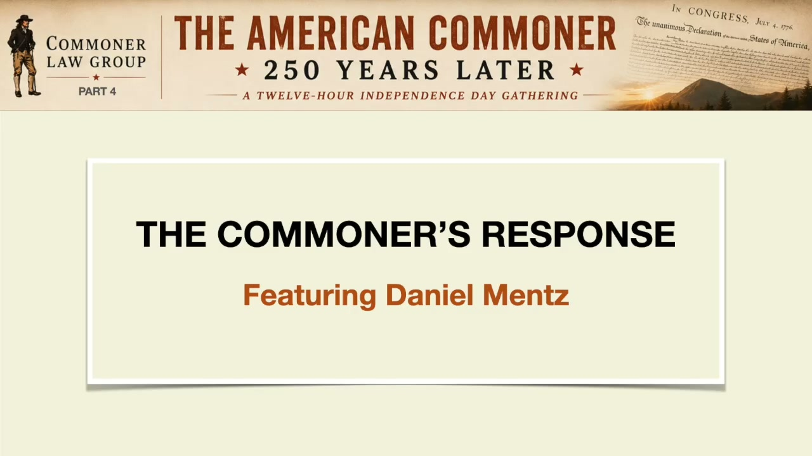
*Slide 1 [\[00:00\]](https://www.youtube.com/watch?v=POZfdI0f4TU&t=0s): "The Commoner's Response," Featuring Daniel Mentz (Part 4 of the Independence Day gathering).*

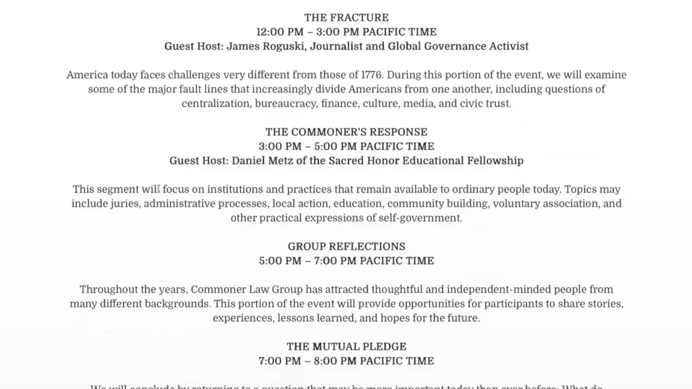
*Slide 2 [\[00:32\]](https://www.youtube.com/watch?v=POZfdI0f4TU&t=24s): The day's schedule page: The Fracture (12:00–3:00 pm PT), The Commoner's Response (3:00–5:00 pm PT; the page spells the guest "Metz"), Group Reflections, The Mutual Pledge.*

- The morning covered the Declaration's promise and grievances; the last three hours "got messy" with divisive topics (free speech, presumption of innocence, due process, whether a crime needs a victim).
- Now "get your solutions hat on." Griess names two enduring problems: today's ordinary crises (economy, energy, food) and the permanent threat of **tyranny**, from oligarchs "who can tip the scales" and mob rule, "and somehow the oligarchs seem to be able to weaponize the mob."
- "No one's coming to save us." The signers took the same stand 250 years ago on the premise that ordinary people can govern themselves "without the need for a hierarchy of institution, whether it's a king or a church or a corporation."
- Griess introduces Mentz as "a friend and brother" and notes he was born in Germany, praising the experimental governance of northern Germany's patchwork of principalities and co-ops.

---

## 3. Mentz: the four pathways and the "dual system" [\[06:25–16:55\]](https://www.youtube.com/watch?v=POZfdI0f4TU&t=377s)

- He had not prepared a presentation ("I always have slides") and wants an open conversation. He introduces himself as National Status & Passport director at Sacred Honor and lists the four pathways: **status correction**, **equity jurisprudence** ("the ancient law that overrules all other laws"), the **trifecta** (trust, private church, PMA) and **land patents**. "Once you combine them… you're the most free American you can be in today's America."
- **The thesis of hope.** "The original organic constitutional republic… still exists." After the Civil War "they overlaid this fictional corporate matrix" (D.C. incorporated in 1871, then the states as sub-corporations), but "Americans can still claim all the rights… it provided."
- He claims an **original [13th Amendment](https://constitution.congress.gov/constitution/amendment-13/)** ("properly ratified in the early 1800s") barred lawyers and title-holders from holding office. "99% of [Congress]" are attorneys. He cites false ratifications and blackmail "during and after the Civil War."
- **A mainstream source:** Eric Foner's *[The Second Founding](https://en.wikipedia.org/wiki/The_Second_Founding)*, recommended by his colleague Troy (the National Status liaison). Foner is, he says, "a pretty mainstream historian," and the book says "there was the pre-Civil War and then there was the post-Civil War America… completely separate systems."

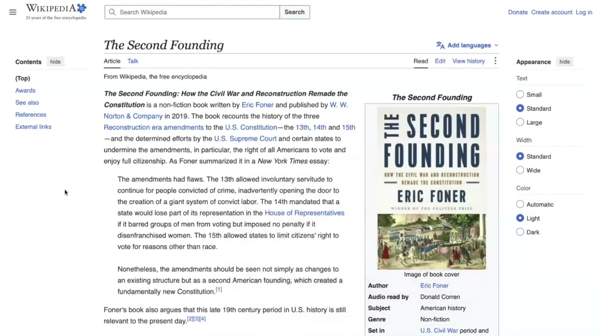
*Slide 3 [\[14:01\]](https://www.youtube.com/watch?v=POZfdI0f4TU&t=833s): The Wikipedia entry for Eric Foner's* The Second Founding*, shown on screen.*

- **Duality everywhere.** Two stamps on the Federal Reserve Note; U.S. citizen vs. national; LLC/S-corp vs. private business trust; real estate vs. land patent. The tax code, he says, shows "this dualistic" structure "if you know how to decipher their legalese."
- He dislikes "patriot lawfare" as a term: it "hints at being belligerent." The remedies can be used "peacefully and honorably."

---

## 4. Consent, anger and the "psyop" [\[16:55–32:00\]](https://www.youtube.com/watch?v=POZfdI0f4TU&t=1007s)

- Why do contracts keep asking "Are you a U.S. citizen? Are you a resident?" Because "they know you have a choice," so **volunteering** without understanding the terms "ensnares" you. "Karmically you're doing it to yourself, and the architects… have clean karmic hands." (The same argument appeared in interviews 01 and 02.)
- **Anger.** Waking up "can trigger anger… all of the directors in our fellowship went through it… you cannot suppress the anger… scream into a pillow, let it out," and then move to solutions. Other remedy groups "come from a place of anger… we got to argue and fight the system."
- **Don't argue.** "As soon as you start defending yourself, now you're acting guilty… the whole point of a judge is to administer a controversy, so if you don't give them any controversy there's nothing left to administer." Public school mock trials "program" people to argue and defend. Asking questions back is "stepping into being a Jedi."
- **The wider frame.** Life from birth to death is "a massive psychological operation… a war on consciousness." Distractions (Supreme Court, Trump, international affairs) "siphon off your life force energy." AI can be "a great tool" or a weapon.
- Griess's reaction: "that was not a rabbit hole, that was a freaking treatise." Any solution "has to come with an accurate map" of reality.

**Griess on Independence Day [\[24:47–27:15\]](https://www.youtube.com/watch?v=POZfdI0f4TU&t=1479s).** For years he had mixed feelings ("did we really get rid of those Brits?") and wanted to avoid the 250th anniversary's "superficial sentimentality," which prompted this event as an alternative: "become a solution… be generative."

---

## 5. Clayton: "stay and fix" through local politics [\[27:15–42:50\]](https://www.youtube.com/watch?v=POZfdI0f4TU&t=1627s)

Clayton (81, California; had vocal-cord cancer, speaks with difficulty) offers a very different map:
- Recommends [Jeffrey Rogers Hummel's book on the Civil War](https://www.amazon.com/dp/0812698436) (he gives the title as *Freeing the Slaves While Enslaving Free Men*), "the end of the First Republic," with a "Second Republic" ending with FDR and the Depression, then a security-state turn after 9/11 ("continuity of government," "quasi martial law").
- Calls out recent surrender of sovereignty "to the IDF and the globalists" via the latest NDAA, the surveillance state (Palantir, data centers as "surveillance centers"), and a "digital prison."
- **Localism and the [Brown Act](https://leginfo.legislature.ca.gov/faces/codes_displaySection.xhtml?lawCode=GOV&sectionNum=54950.5).** California's open-meetings law lets citizens oppose measures at every city council and county government. He used it successfully against local developers and the Park Service, but could not rally Bay Area public-health policy opposition during COVID.
- **Remedy:** build "committees of liberty" from the ground up; address "wealth disparity" produced by central-bank bailouts and crony capitalism (he cites meme coins, Mar-a-Lago fees, and the treatment of a House member); do teach-ins about the central bank and militarism; and form a **third party** (not the Republicans or Democrats).
- Griess asks for a platform. Clayton: firm anti-war stance; equality under the law; repeal victimless-crime laws; bar administrative-state staff from later working for contractors; audit ("where are the missing trillions?"); recall local officials.

**Mentz's reply [\[43:41–47:51\]](https://www.youtube.com/watch?v=POZfdI0f4TU&t=2613s).**
- A third party "is never going to materialize" because "as long as the state or they control the voting machines they will not let anyone… get to power." Voting "has been lobotomized"; the system is "political theater… a Masonic play."
- He is disillusioned with Trump ("turned out to be exactly who many of the anarchists and libertarians told us he would be").
- **Etymology.** "Govern" from Latin *gubernare* means "to rule or control," and "ment" from *mente* means "mind," so "government literally means mind control." Hence **self-governance, not self-government.** (See the closing "Claims worth checking" section.)
- His agreement with Clayton: return to "our local circle of influence." His slogan: **"No voting, no violence, no apathy: exit and build."**

---

## 6. Exit and Build [\[47:51–1:01:00\]](https://www.youtube.com/watch?v=POZfdI0f4TU&t=2863s)

Mentz presents the Exit & Build movement (a Sacred Honor ally event) as "the only way I see forward."

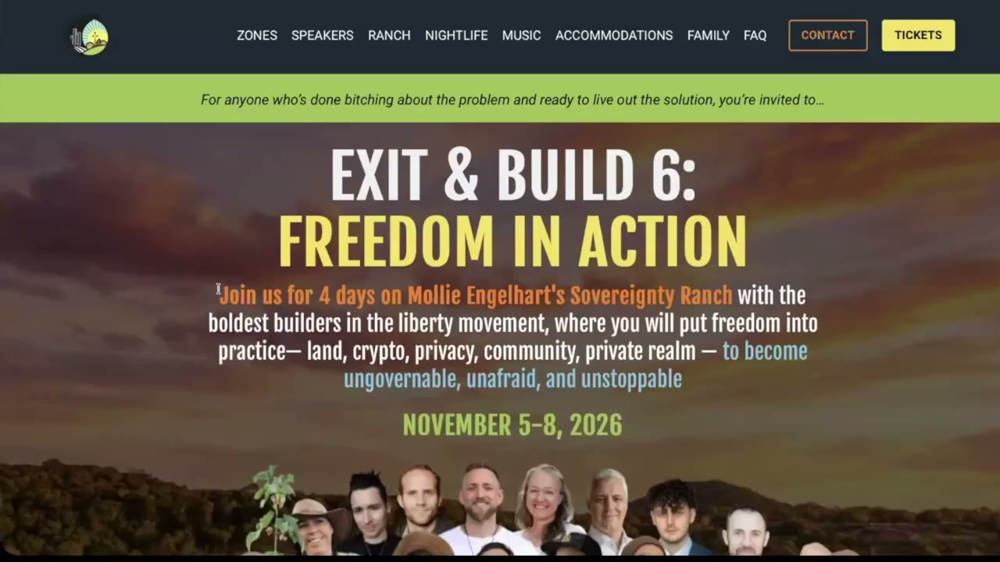
*Slide 4 [\[49:11\]](https://www.youtube.com/watch?v=POZfdI0f4TU&t=2943s): Exit & Build 6: "Freedom in Action," 5–8 November 2026, Mollie Engelhart's Sovereignty Ranch, Bandera, Texas.*

- **Exit & Build 6** is a four-day in-person event, featuring leaders such as Curtis Stone, Alec Zeck, John Bush, Mollie Engelhart, River and Imani, Doug and Stacy Colbert, and Sacred Honor Educational Fellowship. He says it has "implementation zones" where attendees leave with a working crypto wallet, private phone setup, soil/chicken plans and similar.
- "**Consent. It's all about consent.**" As long as people consent to the political system, "the system will continue to be what it is." John Bush, the event's founder, "used to be a big political activist" and concluded politics "keeps getting worse even if your guy makes it into office."
- **The counter-economy.** "We trade outside of the system individually in the private… in whatever currency we choose" (crypto, decentralised internet, "Quartal" node, regenerative soil, community). "The old system is coming down. Why do you think they're getting louder every single day? So you stay distracted and you don't build the new earth."
- "We can peacefully move out… we don't need a bloody revolution." He calls the war narrative ("if you want change you need war") itself a mind-control idea.

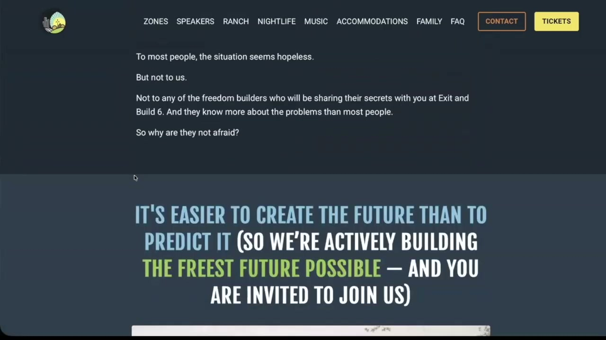
*Slide 5 [\[50:06\]](https://www.youtube.com/watch?v=POZfdI0f4TU&t=2998s): "It's easier to create the future than to predict it."*

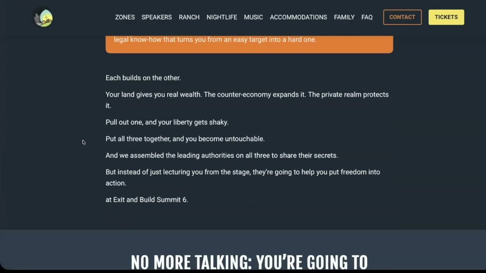
*Slide 6 [\[50:54\]](https://www.youtube.com/watch?v=POZfdI0f4TU&t=3046s): The three pillars as the site frames them: land, counter-economy, private realm ("Each builds on the other").*

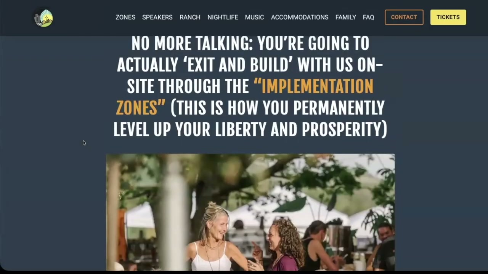
*Slide 7 [\[51:00\]](https://www.youtube.com/watch?v=POZfdI0f4TU&t=3052s): "No more talking: you're going to actually 'exit and build' with us on-site through the implementation zones."*

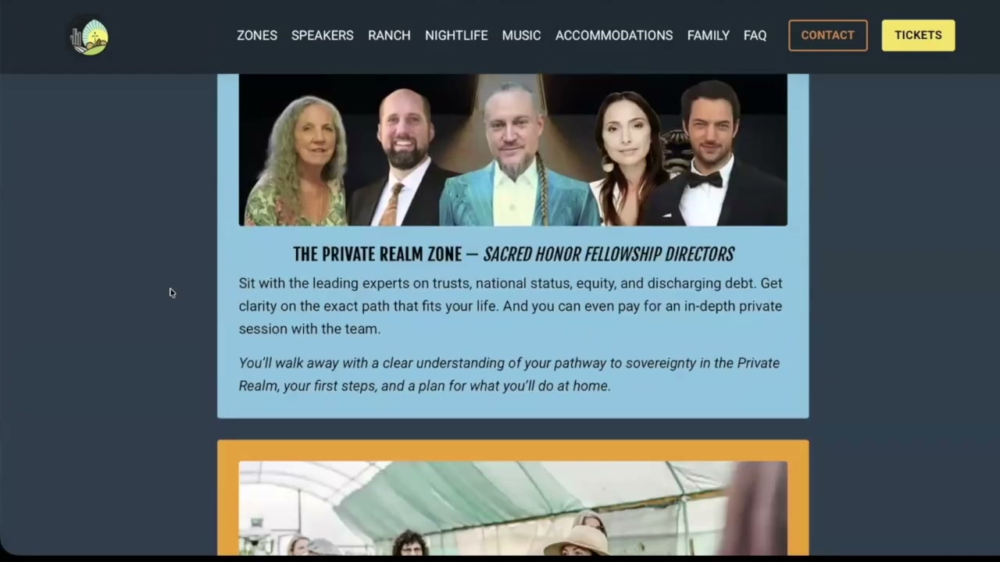
*Slide 8 [\[51:20\]](https://www.youtube.com/watch?v=POZfdI0f4TU&t=3072s): "The Private Realm Zone," led by Sacred Honor Fellowship directors (trusts, national status, equity, discharging debt).*

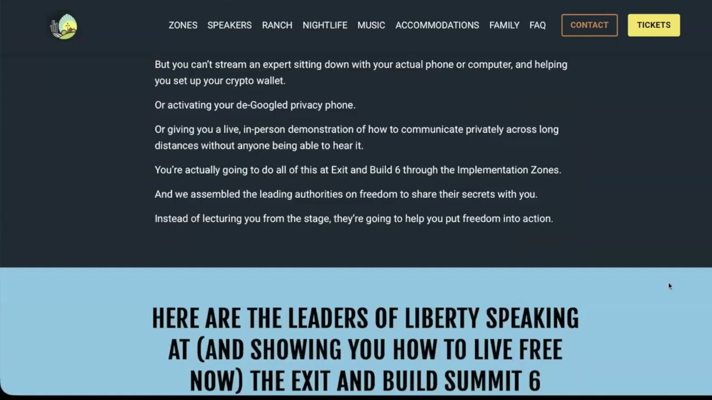
*Slide 9 [\[51:54\]](https://www.youtube.com/watch?v=POZfdI0f4TU&t=3106s): "Here are the leaders of liberty speaking at (and showing you how to live free now) the Exit and Build Summit 6."*

---

## 7. Griess's four strategic pathways [\[55:53–1:00:38\]](https://www.youtube.com/watch?v=POZfdI0f4TU&t=3345s)

| Pathway | Premise | Griess's comment |
|---|---|---|
| **Stay and fix** | The system is redeemable. Do the ordinary organising and change it from within. | Clayton's position. |
| **Exit and build** | The system is irredeemable. Build parallel institutions. | Mentz's position. |
| **Withdraw consent / opt out** | Don't comply (licence, tax, mask, vaccine) "as much as you can," and critical mass of non-consent will collapse the system. | Mentz: "not likely… do you really want to bet on that?", comparable to "sit back, relax, watch the show and eat some popcorn." |
| **Hold power accountable** | Investigate, expose, enforce limits. At the extreme, "build the guillotines." | Griess notes this is "exaggerated perhaps." |

There is also a fifth category, which is just going along (the majority). Griess says each rests on a different judgment about "what is possible." He has organised people since 2020 and found all four are held sincerely. He identifies as "not an exit and build person… if somebody wants to exit and build, and then I'll join after it's built."

His main objection to exit-and-build communities is that they "**overlook governance to their own detriment.**" The event's website covers "farming, food security, water security, ammo… but there's no governance."

---

## 8. Griess's "Juries" excerpt [\[1:01:00–1:11:00\]](https://www.youtube.com/watch?v=POZfdI0f4TU&t=3652s)

Griess plays a segment of his own special presentation, *Juries: The Missing Foundation of Self-Government*. [A Commoner Law Group video](https://www.youtube.com/watch?v=OPyh1dNpT44) (52 minutes) opens with the same title slide.

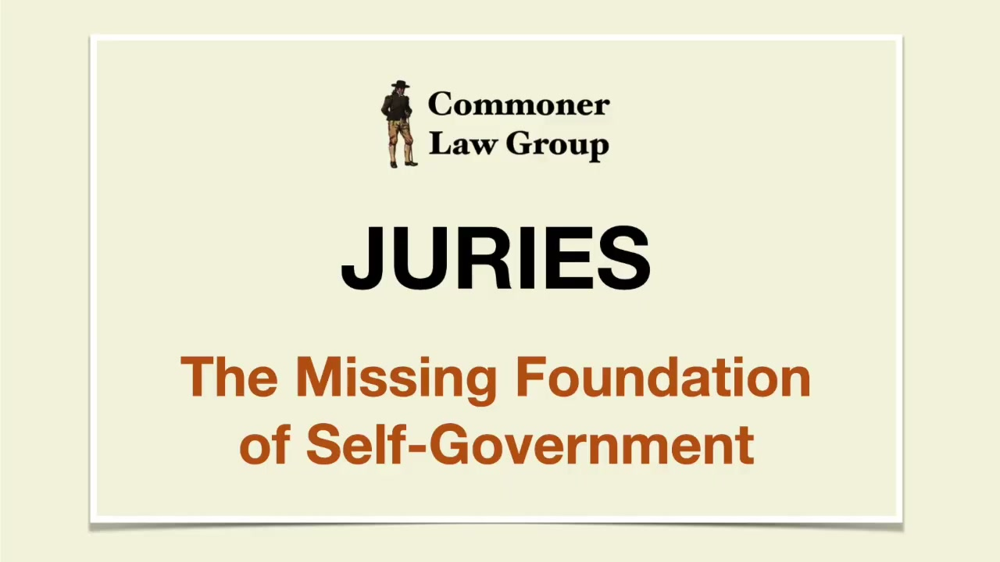
*Slide 10 [\[1:01:29\]](https://www.youtube.com/watch?v=POZfdI0f4TU&t=3681s): "Juries: The Missing Foundation of Self-Government."*

- **Background:** he has organised for years (water-fluoridation campaign, a congressional campaign, medical-freedom packages under the mandates) and kept seeing groups fall apart through "interpersonal matters," above all **people's inability to deal with accusations.** "Trust is lost. And it is the nature of trust that once offended, once broken, it's very hard to restore."
- **The jury principle** as a path from conflict to truth:

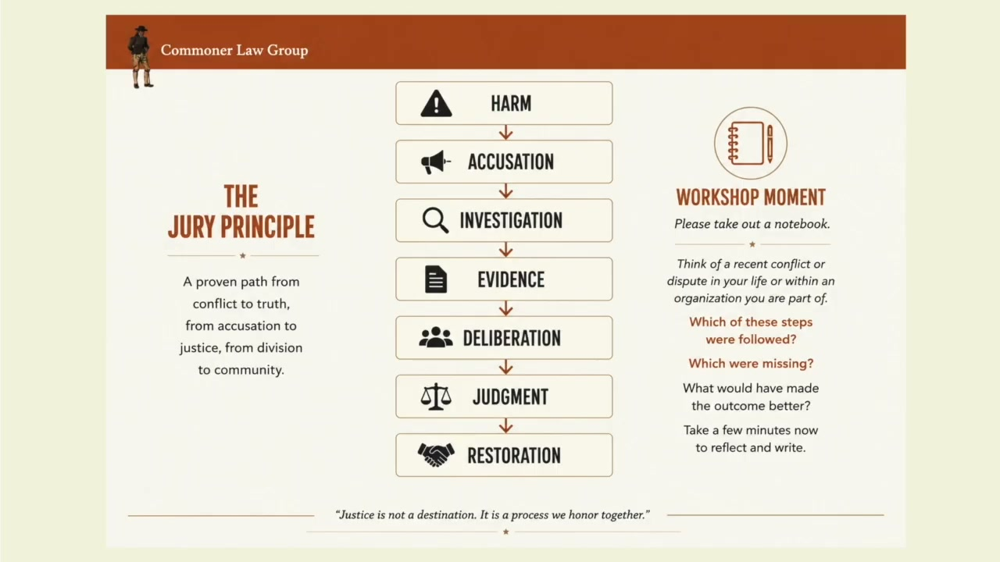
*Slide 11 [\[1:04:26\]](https://www.youtube.com/watch?v=POZfdI0f4TU&t=3858s): Harm → Accusation → Investigation → Evidence → Deliberation → Judgment → Restoration, with a "workshop moment" asking the audience to think of a recent conflict and which steps were missing.*

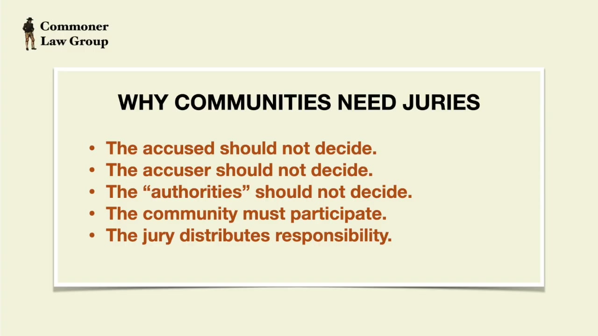
*Slide 12 [\[1:04:58\]](https://www.youtube.com/watch?v=POZfdI0f4TU&t=3890s): Why communities need juries: the accused should not decide; the accuser should not decide; the "authorities" should not decide; the community must participate; the jury distributes responsibility.*

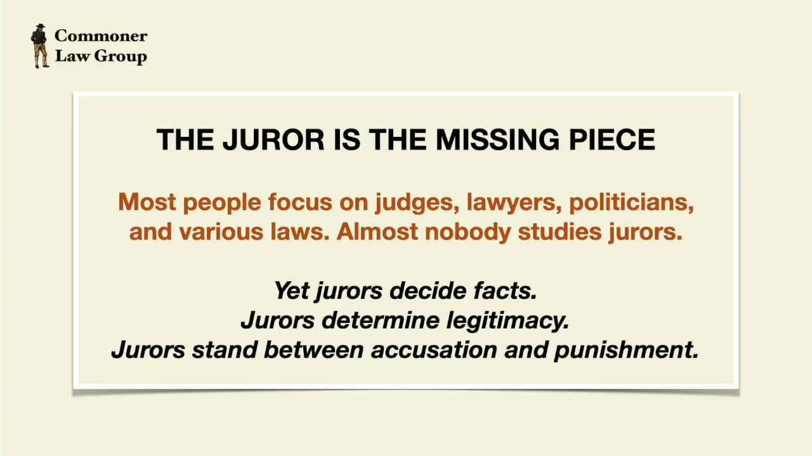
*Slide 13 [\[1:05:42\]](https://www.youtube.com/watch?v=POZfdI0f4TU&t=3934s): "The juror is the missing piece": jurors decide facts, determine legitimacy, and stand between accusation and punishment.*

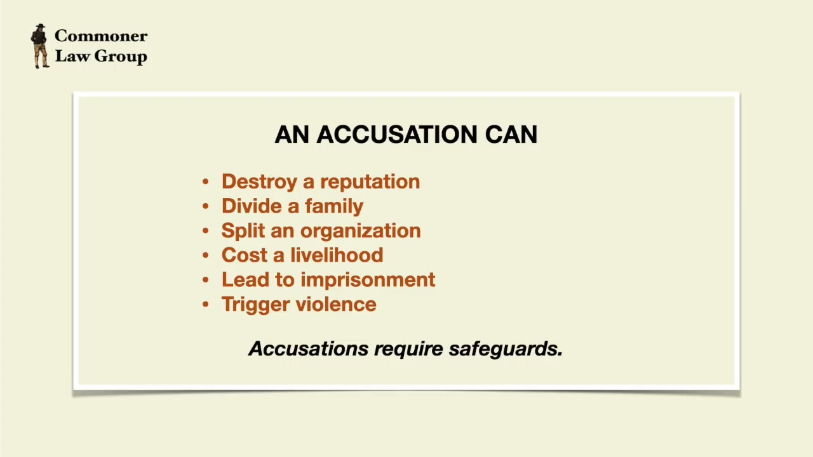
*Slide 14 [\[1:05:57\]](https://www.youtube.com/watch?v=POZfdI0f4TU&t=3949s): An accusation can destroy a reputation, divide a family, split an organisation, cost a livelihood, lead to imprisonment, trigger violence. "Accusations require safeguards."*

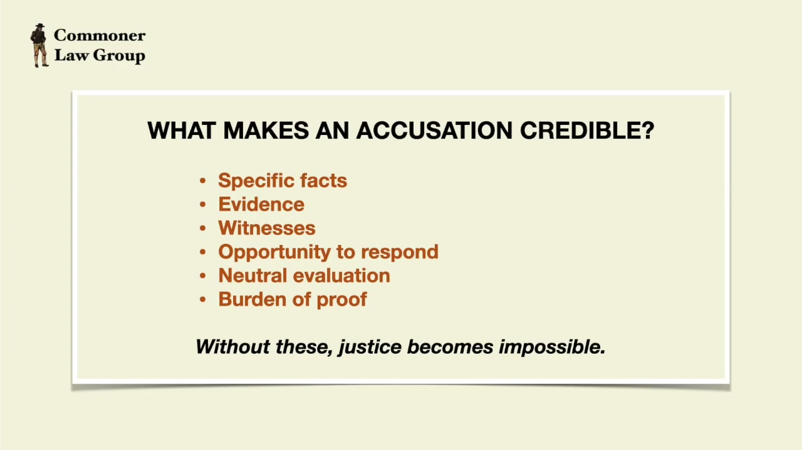
*Slide 15 [\[1:06:21\]](https://www.youtube.com/watch?v=POZfdI0f4TU&t=3973s): A credible accusation has specific facts, evidence, witnesses, opportunity to respond, neutral evaluation, burden of proof.*

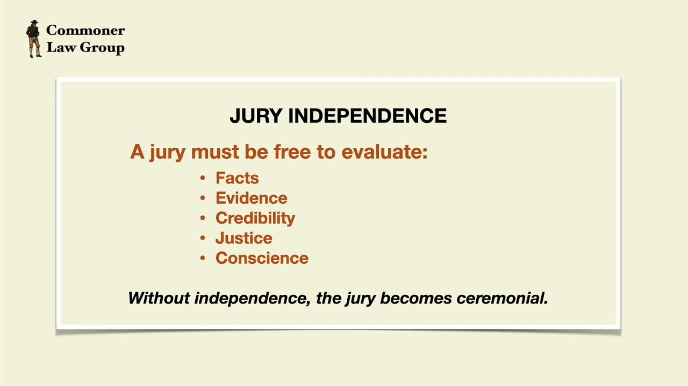
*Slide 16 [\[1:07:07\]](https://www.youtube.com/watch?v=POZfdI0f4TU&t=4019s): Jury independence: facts, evidence, credibility, justice, conscience. "Without independence, the jury becomes ceremonial."*

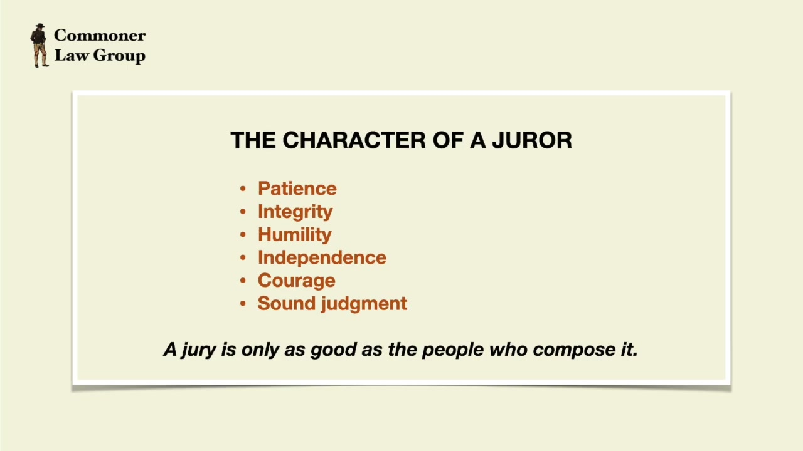
*Slide 17 [\[1:07:34\]](https://www.youtube.com/watch?v=POZfdI0f4TU&t=4046s): Patience, integrity, humility, independence, courage, sound judgment. "A jury is only as good as the people who compose it."*

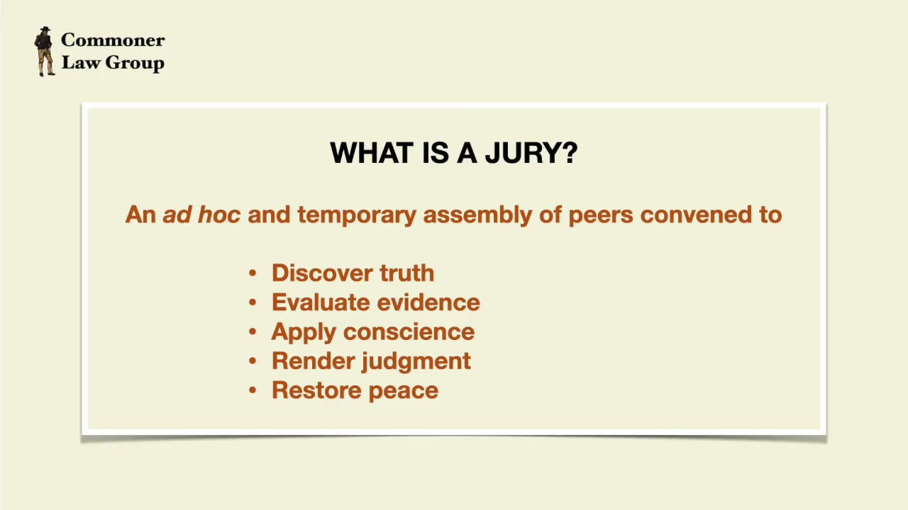
*Slide 18 [\[1:08:10\]](https://www.youtube.com/watch?v=POZfdI0f4TU&t=4082s): "An ad hoc and temporary assembly of peers convened to discover truth, evaluate evidence, apply conscience, render judgment, restore peace."*

- A group "could have an autocratic structure" (he cites the Waco compound under David Koresh) if "by consent of the people," but "in a self-governing society… you want to distribute the decision-making in a jury."
- The accuser must "fully accept that it's his or her **burden of proof**," which "eliminates a lot of accusations."
- His challenge: "the day that an exit and build organization leads with something like governance and puts the jury square in the middle… that's when I'll jump on."

**Mentz's response [\[1:08:00–1:11:30\]](https://www.youtube.com/watch?v=POZfdI0f4TU&t=4072s).** "A fantastic lens," and "governance comes before all the other things." He notes successful intentional communities, for instance one founded in 1968 that decides **by consensus** of all members ("some of the decisions they take years"), and says different models suit different people.

---

## 9. Audience contributions [\[1:11:30–1:41:00\]](https://www.youtube.com/watch?v=POZfdI0f4TU&t=4282s)

**Sarah (upstate New York) [\[1:12:00–1:20:00\]](https://www.youtube.com/watch?v=POZfdI0f4TU&t=4312s).**
- A Sacred Honor national-status course member who "changed [her] status three times." She recaps the [14th Amendment](https://constitution.congress.gov/constitution/amendment-14/)/federal-citizenship argument ("slaves to the corporation… started in 1871"; "[28 USC 3002](https://www.law.cornell.edu/uscode/text/28/3002)") and says local and state governments "are all their own corporations… you can find them on Dun & Bradstreet."
- Mentz thanks her for the recap and says the status process currently applies to Americans, but "there has to be a way for us to do status correction in other [Western] countries" and they are "looking for volunteers" in Canada. He observes that the exit-and-build community took "years" to accept lawful remedies: they were "buying land in the country somewhere but they were still U.S. citizens still paying income tax and property tax… so how free are you really?" People "who don't want to look at the law stuff" must face it: "it is part of self-governance."
- Griess adds that exit-and-build does not require relocating: one can "construct this security fence around your private world right where you are."

**Audrey (retired military; former trucking business owner) [\[1:21:35–1:33:00\]](https://www.youtube.com/watch?v=POZfdI0f4TU&t=4887s).** Asks beginner questions after four years of learning:
- She sent state-assembly "status" paperwork and received IRS letters. She wonders whether status papers were "an affront" and notes the IRS still treats her as a citizen.
- **Notice of liability.** Mentz says that is "not something we directly do inside the fellowship," but that allies at In Power Movement (Cal Washington, [inpowermovement.org](https://www.inpowermovement.org)) do it and "we know for a fact that it works." He distinguishes it from equity, "equity is more of a defense, the notice of liability is more of an offense," and says it requires no status correction. He mentions a "bloodline royalty" stepping down after notices, which he does not detail.
- **Is a parallel system like Sharia law?** Mentz: "not technically," because Sharia as a government system "is imposed upon the whole land," while each self-governing community here has its own model and trades with others "for mutual aid and benefit." He names the overarching term **agorism**: "a true free market without any kind of centralized oversight."

**Tamara [\[1:33:00–1:42:30\]](https://www.youtube.com/watch?v=POZfdI0f4TU&t=5572s).**
- Corrects military status with **[DD Form 2168](https://www.esd.whs.mil/Directives/forms/dd2000_2499/DD2168/)** (she says it exits "forever" military obligations).
- Asks whether the fellowship has coordinated with the other status groups ("status correction palooza"), noting the commercial incentives and the confusion. Mentz says he has **not** reached out to American State National or American National groups. He says people who have come from them to the Fellowship "with severe problems" and that "all I've seen… is just more trouble than actual remedy." The Fellowship's **citizenship evidence affidavit** has been used since 2007, is "strong enough… on every level of government from the federal to military to state, county, city," and "opts you out of income tax without many issues, even state income tax."
- She describes turning six credit-card accounts into trusts and says all are "in default," which she expects to be tested in court.
- On infiltrating local government: Mentz says infiltration will not work ("how easily they manipulate and basically blackmail people") and recommends **Daniel Mercury**, a former California candidate. He does say "we've gotten **sheriffs** on board… that's how we can flip a county," and that several counties "have flipped basically into common law." He adds that some officials may be "MK Ultra"-captured without knowing it.

---

## 10. Close [\[1:42:35–1:43:42\]](https://www.youtube.com/watch?v=POZfdI0f4TU&t=6147s)

Griess thanks everyone "for hanging out on your Independence Day" and defines commoners: "no one's royalty, but we're not also slaves… The American law is established of, for, and by common people like you and me."

---

## 11. Claims worth checking before reliance

These are observations for a public reader, not rebuttals.

1. **"Original [13th Amendment](https://constitution.congress.gov/constitution/amendment-13/)" (Titles of Nobility Amendment).** The 1810 proposed amendment would have stripped citizenship from those accepting foreign titles. It is widely held *not* to have been ratified, and nothing in its text refers to attorneys. The claim in the talk (properly ratified, bars lawyers from office) is contested and should be checked against primary sources.
2. **Etymology of "government."** *Gubernare* ("to steer, to govern") comes from Greek *kybernan*, and *-ment* is a noun suffix (from Latin *-mentum*, "result of"), not *mens* ("mind"). The "mind control" derivation is a popular claim, not the standard etymology.
3. **Legal statements by the host and guests** (D.C. incorporated in 1871, "[28 USC 3002](https://www.law.cornell.edu/uscode/text/28/3002)," the [14th Amendment](https://constitution.congress.gov/constitution/amendment-14/) as federal-citizenship "slavery," local governments as corporations on Dun & Bradstreet) are repeated from interview 01. See the closing "Claims worth checking" section of that summary for notes. For example, [§ 3002](https://www.law.cornell.edu/uscode/text/28/3002)'s definitions apply "as used in this chapter."
4. **[DD Form 2168](https://www.esd.whs.mil/Directives/forms/dd2000_2499/DD2168/).** A guest says this form "corrects your status with the military" and exits the "forever" obligation. The Department of Defense forms index (esd.whs.mil) lists DD 2168 as "Application for Discharge of Member or Survivor of Member of Group Certified to Have Performed Active Duty with the Armed Forces of the U.S." (a form for certain civilian groups), not a general status-correction or separation form. Confirm what the form is for before relying on it.
5. **Hummel's book.** Clayton's wording for the title is approximate. The author's book is generally cited as *[Emancipating Slaves, Enslaving Free Men](https://www.amazon.com/dp/0812698436)* (the Open Court second edition is the Amazon listing).
6. **Voting machines and third parties.** Mentz's claim that a third party "is never going to materialize" is an opinion about election integrity that the call does not support with evidence. The NDAA, Palantir and "IDF" statements by Clayton are also assertions without sources on the call.
7. **Outcome claims.** Counties "flipped into common law," sheriffs on board, notices of liability producing resignations, and the status affidavit stopping state income tax "without many issues" are anecdotal and uncited.
8. **Promotion.** Exit & Build 6 (5–8 November 2026, Texas), the Fellowship's courses and Griess's other programs are mentioned throughout. The video description links to the paid National Status & Passport course page, and Mentz appears as a featured guest of the event.